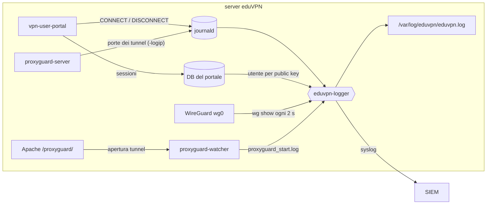
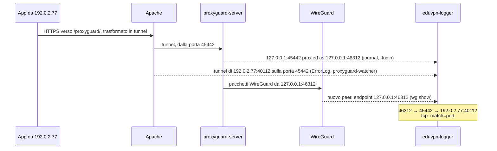

# eduvpn-logger

*🇬🇧 [Read in English](README.md)*

[](LICENSE)
[](#requisiti)
[](https://www.eduvpn.org/)
[](#requisiti)

**Chi si è connesso al tuo server [eduVPN](https://www.eduvpn.org/), da dove e
quando: una riga di log per ogni evento di sessione WireGuard, in tempo reale,
pronta per il tuo SIEM.**

eduVPN registra l'indirizzo da cui si connette un client VPN solo per OpenVPN:
la [documentazione di eduVPN](https://docs.eduvpn.org/server/v3/logging.html)
lo dice esplicitamente (*"currently only available when clients connect using
OpenVPN"*). Con WireGuard nessun log risponde alle domande che prima o poi un
team di risposta agli incidenti deve affrontare: *quale account c'era dietro
203.0.113.45 ieri notte? Da dove si è connessa giulia? Quando è iniziata e
finita quella sessione?* Il portale conosce l'utente ma non l'indirizzo.
WireGuard conosce l'indirizzo ma non l'utente, non ha il concetto di
connessione e non registra nulla. Dietro ProxyGuard, il ripiego di eduVPN che
trasporta WireGuard su HTTPS, perfino il kernel vede ogni client come
`127.0.0.1`.

**eduvpn-logger colma questa lacuna.** Segue in tempo reale il portale,
WireGuard e Apache, li unisce sulla public key WireGuard e scrive una riga
`chiave=valore` per ogni evento di sessione (`connect`, `roam`, `disconnect`)
su file e su syslog:

```
2026-04-15T09:58:03.412871+02:00 event=connect user=giulia profile=staff device=ios conn=soAQTNO...= tunnel_ip4="10.20.0.5" tunnel_ip6="fd00:20::5" src_ip="203.0.113.45" src_port=48049 transport=udp country="Italy" city="Trieste"
2026-04-15T10:41:22.090113+02:00 event=roam user=giulia profile=staff device=ios conn=soAQTNO...= tunnel_ip4="10.20.0.5" tunnel_ip6="fd00:20::5" src_ip_old="203.0.113.45" src_port_old=48049 src_ip="198.51.100.12" src_port=51234 transport=udp country="Italy" city="Trieste"
2026-04-15T11:02:57.731204+02:00 event=disconnect user=giulia profile=staff device=ios conn=soAQTNO...= bytes_in=227252 bytes_out=49292 src_ip="198.51.100.12" src_port=51234 transport=udp country="Italy" city="Trieste"
2026-04-15T12:10:04.861203+02:00 event=connect user=marco profile=students device=windows conn=GUUepz8z...= tunnel_ip4="10.20.1.9" tunnel_ip6="fd00:21::9" src_ip="192.0.2.77" src_port=40112 transport=tcp tcp_match=port country="Austria" city="Vienna"
2026-04-15T13:27:41.528310+02:00 event=disconnect user=marco profile=students device=windows conn=GUUepz8z...= bytes_in=18733211 bytes_out=402115980 src_ip="192.0.2.77" src_port=40112 transport=tcp inferred=1 country="Austria" city="Vienna"
```

*giulia si connette da casa, passa alla rete mobile e si disconnette; marco
raggiunge il server tramite ProxyGuard, poi il portatile di marco va in
sospensione (public key abbreviate).*

- **Completo**: utente, profilo, dispositivo, indirizzi del tunnel, IP e porta
  pubblici di provenienza (IPv4 e IPv6), trasporto, traffico, paese e città.
- **Vede oltre ProxyGuard**: ricava l'indirizzo reale dei client che
  trasportano WireGuard su HTTPS, in modo esatto con ProxyGuard 2.1.1 o
  successivo, e dice come ha trovato ciascuno.
- **Autosufficiente**: un daemon Python in un solo file, solo standard
  library, più un piccolo servizio di supporto per ProxyGuard. Niente da
  compilare, nessuna patch a eduVPN, nessun modulo del kernel.
- **Pronto con un comando** su ogni sistema supportato da eduVPN 3: attiva in
  eduVPN quello che gli serve, verifica ogni modifica e controlla il risultato.
- **In produzione** all'Università di Trieste (una release precedente).

## Indice

- [Il problema](#il-problema)
- [Cosa lo rende diverso](#cosa-lo-rende-diverso)
- [Come funziona](#come-funziona)
- [Requisiti](#requisiti)
- [Installazione](#installazione)
- [Configurazione](#configurazione)
- [Formato del log](#formato-del-log)
- [Usare il log](#usare-il-log)
- [Limiti](#limiti)
- [Sicurezza e privacy](#sicurezza-e-privacy)
- [Aggiornamento e rimozione](#aggiornamento-e-rimozione)
- [Domande frequenti](#domande-frequenti)
- [Progetti collegati](#progetti-collegati)
- [Riconoscimenti](#riconoscimenti)
- [Licenza](#licenza)

## Il problema

Su un server eduVPN ogni informazione su una sessione WireGuard sta in un posto
diverso, e nessuna basta da sola:

| Sorgente | Sa | Non sa |
|---|---|---|
| Portale (`vpn-user-portal`) | utente, profilo, public key, indirizzi del tunnel e traffico di ogni sessione | da dove si connette il client: lo registra solo per OpenVPN |
| WireGuard | public key, endpoint attuale, ultimo handshake e traffico di ogni peer | utenti, connessioni, storia: non registra nulla, e un nuovo endpoint sostituisce in silenzio il precedente |
| Apache, con ProxyGuard | l'indirizzo reale di ogni tunnel TCP | quale peer WireGuard viaggia nel tunnel; il suo access log scrive una richiesta solo quando finisce, giorni dopo per un tunnel lungo |
| proxyguard-server | a quale connessione di Apache appartiene ogni porta di provenienza vista da WireGuard: lo registra da ProxyGuard 2.1, se richiesto (`-logip`) | l'indirizzo del client |

La public key WireGuard è l'unico identificatore che portale e WireGuard hanno
in comune, e solo proxyguard-server, nel mezzo, sa quale tunnel di Apache
arriva a WireGuard da quale porta. I logger WireGuard generici, come
[wglogger](https://codeberg.org/flaruina/wglogger), registrano public key ed
endpoint ma lasciano a te l'unione con il portale, e non vedono oltre
ProxyGuard, il cui traffico arriva a WireGuard da `127.0.0.1`. eduvpn-logger
ricostruisce i collegamenti mancanti, in tempo reale.

## Cosa lo rende diverso

- **Sessioni su un protocollo senza connessioni.** WireGuard conserva solo
  l'endpoint attuale e l'ora dell'ultimo handshake di ogni peer. eduvpn-logger
  li legge ogni 2 secondi e ne ricava gli eventi di connect, roam e
  disconnect: nessun modulo del kernel, niente conntrack né eBPF, nessuna patch
  a eduVPN.
- **L'indirizzo reale dietro ProxyGuard, esatto.** Apache conosce il client di
  un tunnel TCP, WireGuard conosce il peer, e solo proxyguard-server sa chi è
  chi. Con ProxyGuard 2.1.1 o successivo eduvpn-logger fa registrare a
  proxyguard-server la connessione di Apache dietro ogni porta di provenienza
  vista da WireGuard, e ad Apache la porta di quella connessione all'apertura
  del tunnel: l'indirizzo si segue porta per porta dal peer WireGuard fino al
  client (`tcp_match=port`). Con un ProxyGuard precedente, che non registra
  nulla per tunnel (o la cui unit non può ricevere `-logip` in sicurezza,
  2.1.0), l'apertura del tunnel viene abbinata nel tempo
  all'handshake WireGuard (`tcp_match=time`), ogni apertura attribuita una sola
  volta, e `tcp_candidates` dice quanti tunnel erano possibili, così un
  abbinamento ambiguo si riconosce come tale.
- **L'identità dalla fonte autorevole.** Utente e profilo arrivano dal
  portale: dalla riga del suo database per la public key della sessione
  (aperto in sola lettura), altrimenti dal suo evento CONNECT. Il portale
  scrive gli identificativi utente nelle
  righe di log così come sono, quindi una riga in cui un identificativo imita
  il template (per farsi passare per un altro utente, o per la chiave di
  un'altra sessione) viene scartata, mai letta male.
- **Riavvii senza strappi.** La posizione nel journal viene salvata dopo ogni
  evento del portale, e le sessioni aperte quando il servizio si ferma: dopo
  un aggiornamento o un riavvio del server gli eventi registrati nel frattempo
  vengono elaborati per primi, con il loro timestamp originale, le sessioni
  attive proseguono senza un secondo `connect` e quelle terminate nel
  frattempo ricevono il loro `disconnect`.
- **Costruito sul comportamento reale di eduVPN.** I peer ricreati da
  `vpn-maint-apply-changes` (contatori azzerati, nessun handshake) non chiudono
  le loro sessioni né perdono il traffico totalizzato. Una public key riusata
  tramite l'API apre una sessione nuova. Un NAT che cambia solo la porta non è
  un roam. Una connessione mobile instabile produce al massimo una riga roam
  ogni 30 s, e l'ultimo spostamento non va mai perso. Una sessione chiusa dal
  portale mentre `wg show` è in corso non viene riaperta.
- **Adatto ai SIEM.** Una riga per evento, chiavi in ordine fisso, l'ora
  dell'evento riportata nella copia syslog, e i valori forniti dagli utenti
  sanificati, così non possono falsificare chiavi, mentre gli identificativi
  federati (eduPersonTargetedID, pairwise-id) restano intatti.
- **Sicuro per impostazione predefinita.** Gli eventi del portale sono
  accettati solo da account di sistema, in base all'UID del mittente che
  journald registra e che il mittente non può falsificare, e le righe di
  proxyguard-server solo dal suo servizio, in base alla unit che journald
  registra. Il servizio gira in
  una sandbox systemd con quattro capability e senza accesso alla rete. I log
  sono privati (`0640 root:adm`) e conservati 180 giorni.
- **Pronto all'uso.** `install.sh` lo installa con un comando, attiva il log
  delle connessioni del portale, il trace ProxyGuard di Apache e il log dei
  tunnel di proxyguard-server se sono spenti (ogni modifica verificata prima di
  essere applicata, con backup, e il riavvio di proxyguard-server chiesto prima)
  e controlla il risultato; `install.sh --uninstall` lo rimuove. Provato su Debian, Ubuntu,
  AlmaLinux e Fedora, e su server eduVPN 3 reali.

## Come funziona



Il daemon legge queste sorgenti e le unisce sulla **public key WireGuard**:

| Sorgente | Cosa fornisce | Come viene letta |
|---|---|---|
| eventi del portale | utente, profilo, public key, IP del tunnel, traffico | journald, `SYSLOG_IDENTIFIER=vpn-user-portal`, dalla posizione salvata |
| database del portale | utente, profilo, IP del tunnel e app di una public key | `/var/lib/vpn-user-portal/db.sqlite`, tabella `wg_peers`, sola lettura, a ogni CONNECT e per i peer senza evento del portale |
| WireGuard | endpoint (`IP:porta` pubblici), ultimo handshake, traffico di ogni peer | `wg show all dump`, ogni 2 s |
| ProxyGuard *(opzionale)* | `IP:porta` reali del client di ogni tunnel TCP, alla sua apertura, e la porta della connessione di Apache verso proxyguard-server | `ErrorLog` di Apache → `proxyguard-watcher` → `proxyguard_start.log` |
| proxyguard-server *(ProxyGuard 2.1+)* | la porta di provenienza che WireGuard vede per ogni connessione di Apache | journald, `SYSLOG_IDENTIFIER=proxyguard-server`, con `-logip` |

### Dallo stato di WireGuard alle sessioni

WireGuard non ha il concetto di connessione, quindi gli eventi sono ricavati
dallo stato dei peer letto a ogni interrogazione:

- **connect**: un peer inizia a fare handshake. Se il portale ha annunciato la
  sessione, la riga viene scritta subito, con l'ora dell'evento del portale e
  la provenienza dell'handshake. Altrimenti attende fino a 10 s che l'evento
  del portale o il suo database indichino l'utente, e porta l'ora del primo
  handshake. Una sessione annunciata dal portale che non fa handshake entro 2
  minuti viene scritta senza provenienza, che arriva poi in una riga roam
  all'arrivo dell'handshake.
- **roam**: cambia la provenienza di un peer attivo, compreso il passaggio tra
  UDP e ProxyGuard. Un cambio della sola porta (rebinding NAT) è ignorato. Al
  massimo una riga roam per peer ogni 30 s: uno spostamento dentro
  quell'intervallo viene scritto alla sua fine, con l'ora in cui è avvenuto, a
  meno che il peer non sia tornato dov'era.
- **disconnect**: quando l'app eduVPN si disconnette si usa il DISCONNECT del
  portale, con i suoi contatori di traffico. Altrimenti (client WireGuard
  generico, portatile in sospensione, rete persa) la sessione termina dopo
  180 s senza handshake, la durata delle chiavi di WireGuard, con i contatori
  di WireGuard, e la riga porta l'ora dell'ultimo handshake più 180 s. Se il
  traffico riprende sulla stessa chiave, si apre una nuova sessione dello
  stesso utente.

Utente e profilo vengono dal database del portale tramite la public key,
oppure dall'evento CONNECT del portale; gli indirizzi del tunnel dall'evento,
oppure dal database; `-` se nessuno dei due la conosce. Una sessione annunciata dal portale resta aperta fino al
suo DISCONNECT, per quanto tardi arrivi l'handshake: una configurazione
scaricata dal portale e usata per la prima volta giorni dopo riceve la
provenienza in una riga `roam`.

`device` deriva dall'ID client OAuth delle app eduVPN, Let's Connect! e govVPN,
così come lo registra il portale. Le righe connect e disconnect non supportate
da un evento del portale hanno **`inferred=1`** (le righe roam vengono sempre da
WireGuard).

### ProxyGuard: ricavare l'indirizzo reale del client

Sulle reti che bloccano UDP le app eduVPN raggiungono WireGuard tramite
[ProxyGuard](https://docs.eduvpn.org/server/v3/wireguard.html): una
connessione HTTPS ad Apache, trasformata in tunnel e passata a
`proxyguard-server`, che consegna i pacchetti WireGuard alla porta UDP locale.
WireGuard vede quindi ognuno di questi client come `127.0.0.1`, ogni tunnel da
una porta sua.



Con quello che `install.sh` configura, due righe descrivono ogni tunnel quando
si apre. Apache (con il trace delle sole richieste di ProxyGuard, qualunque sia
il loro percorso) scrive `AH10212 ... tunnel running` con il client,
`[client 192.0.2.77:40112]`, e la porta locale della sua connessione verso
proxyguard-server, `[pgport 45442]`; `proxyguard-watcher` la trasforma in un
evento di apertura. proxyguard-server (ProxyGuard 2.1 o successivo, `-logip`;
configurato da `install.sh` dalla 2.1.1)
scrive la porta di provenienza che quella connessione ha verso WireGuard:
`127.0.0.1:45442 proxied as 127.0.0.1:46312`. Un peer WireGuard che compare su
`127.0.0.1:46312` si segue così fino al suo client: `tcp_match=port`. Le porte
vengono riusate nel tempo, quindi si uniscono solo righe dello stesso momento:
l'apertura e la riga di proxyguard-server entro 5 s l'una dall'altra, entrambe
degli ultimi 30 s.

Senza la riga di proxyguard-server (ProxyGuard precedente alla 2.1, che non
registra nulla per tunnel; ProxyGuard 2.1.0 senza la configurazione manuale;
proxyguard-server non ancora riavviato dopo `install.sh`; una riga persa) una nuova sessione WireGuard, o un nuovo tunnel
di una sessione attiva, viene abbinata all'apertura più vicina nel tempo, da
circa 30 s prima a 3 s dopo il momento in cui WireGuard la vede, escluse le
aperture che proxyguard-server mostra appartenere ad altri tunnel:
`tcp_match=time`, con `tcp_candidates` il numero di aperture nella finestra
(`1`: nessun altro candidato). In entrambi i casi un'apertura viene assegnata
una sola volta, così non può essere data a un altro client, e se non è ancora
arrivata il connect la attende fino a 20 s.

### Tempi

| Cosa | Default | Impostazione |
|---|---|---|
| intervallo di lettura di WireGuard | 2 s | `EDUVPN_WG_POLL_SEC` |
| attesa dell'utente di un nuovo peer | 10 s | `EDUVPN_CONNECT_GRACE_SEC` |
| attesa dell'apertura ProxyGuard di una sessione TCP | 20 s | — |
| attesa del primo handshake di una sessione annunciata dal portale | 120 s | — |
| finestra di abbinamento ProxyGuard (per porta e nel tempo) | 30 s + una lettura prima, 3 s dopo che WireGuard vede il tunnel | — |
| apertura e riga di proxyguard-server dello stesso tunnel | entro 5 s | — |
| intervallo minimo tra righe roam dello stesso peer | 30 s | `EDUVPN_ROAM_MIN_INTERVAL_SEC` |
| silenzio dell'handshake prima di un disconnect dedotto | 180 s (minimo) | `EDUVPN_DISCONNECT_AFTER_SEC` |

### Stato

`/var/lib/eduvpn-logger` conserva la posizione nel journal e, mentre il
servizio è fermo, le sessioni aperte (`sessions.json`, leggibile solo da
root). All'avvio le sessioni vengono ripristinate e il file rimosso, si
elaborano gli eventi del portale registrati nel frattempo, e così le aperture
dei tunnel ProxyGuard avvenute nel frattempo, e solo dopo si legge WireGuard:
una sessione chiusa dal portale nel frattempo riceve il disconnect
del portale, una rimasta in silenzio quello dedotto, una attiva prosegue (una
sessione ProxyGuard conserva il suo indirizzo reale). Tutto il resto è in
memoria e limitato alle sessioni attive: a ogni lettura viene riallineato con
`wg show`, e il lavoro di ogni lettura cresce linearmente con il numero di
peer. Dopo un crash non c'è stato salvato: le sessioni ancora attive vengono
annunciate di nuovo (vedi [Limiti](#limiti)). Una posizione nel journal
corrotta o scaduta, o un `sessions.json` inutilizzabile, viene riconosciuta,
segnalata, e il daemon riparte dal momento attuale.

## Requisiti

- Server eduVPN v3 (`vpn-user-portal`) con WireGuard, su qualunque sistema
  supportato da eduVPN 3: Debian, Ubuntu, Enterprise Linux (RHEL, AlmaLinux,
  Rocky) e Fedora. Provato su Debian 13, Ubuntu 22.04, 24.04 e 26.04,
  AlmaLinux 9 e 10, Fedora 43 e 44.
- Portale e WireGuard sulla stessa macchina: il daemon legge journal e database
  del portale ed esegue `wg show` in locale. Le installazioni multi-nodo, con il
  portale su un controller separato, non sono supportate.
- systemd; `wireguard-tools` (`wg`) e Python ≥ 3.9, solo standard library
  (entrambi installati da `install.sh` se mancano).
- I template di connect/disconnect (consigliati) richiedono vpn-user-portal ≥
  3.5.0; anche il formato di log predefinito del portale è riconosciuto.
- Il database del portale viene letto solo se è SQLite, il default di eduVPN.
  Con PostgreSQL o MariaDB tutto funziona dagli eventi del portale, senza il
  ripiego sul database (vedi [Limiti](#limiti)).
- *Opzionale:* ProxyGuard 2.1.1 o successivo (`proxyguard-server` dal
  repository di eduVPN, sulla stessa macchina) per indirizzi ProxyGuard esatti;
  con uno precedente vengono abbinati nel tempo (2.1.0: esatti solo con la
  [configurazione manuale](#configurazione-manuale)).
- *Opzionale:* `python3-maxminddb` e un database MaxMind GeoLite2-City per
  `country` e `city` ([GeoIP](#geoip-opzionale)).

## Installazione

Sul server eduVPN:

```bash
git clone https://github.com/giacomocamata/eduvpn-logger.git
cd eduvpn-logger
sudo ./install.sh
```

Su un server eduVPN standard non serve altro: `install.sh` installa il logger,
attiva lato eduVPN quello che gli serve se è spento, avvia tutto e lo verifica.
È idempotente: rieseguilo per aggiornare, o dopo aver cambiato la configurazione
di eduVPN.

| Parte | Cosa fa `install.sh` |
|---|---|
| log delle connessioni del portale | se è spento lo attiva in `/etc/vpn-user-portal/config.php` con i template consigliati. La modifica viene verificata con PHP prima di sostituire il file, l'originale resta in `config.php.eduvpn-logger.bak` e i template già impostati restano com'erano. |
| IP di provenienza ProxyGuard | se un VirtualHost inoltra ProxyGuard (`/proxyguard/`, o qualunque percorso con upgrade a `UoTLV`): fa registrare ad Apache le aperture dei tunnel, con un file di configurazione proprio (`eduvpn-logger-proxyguard.conf`, poi `configtest` e reload graceful; se il `configtest` fallisce resta la versione precedente, o nessuna), e avvia `proxyguard-watcher` sull'`ErrorLog` di quel VirtualHost |
| ProxyGuard, esatto (2.1.1 o successivo) | nello stesso file, a livello di server, il formato di default dell'error log di Apache più la porta della connessione di ogni tunnel verso proxyguard-server, solo nelle righe di trace (un `ErrorLogFormat` già tuo non viene toccato: vedi [Configurazione manuale](#configurazione-manuale)); un drop-in, `proxyguard-server.service.d/eduvpn-logger.conf`, che imposta `OTHER_ARGS=-logip` per proxyguard-server, lasciando la riga di comando al pacchetto. Riavviare proxyguard-server fa cadere i tunnel ProxyGuard aperti (le app si riconnettono subito), quindi lo chiede; senza terminale lo lascia a te, con una nota. Con ProxyGuard precedente alla 2.1 non cambia nulla e il controllo dice di aggiornarlo; con la 2.1.0, la cui unit non ha `OTHER_ARGS`, non cambia nulla nemmeno (sostituirne la riga di comando potrebbe fermare proxyguard-server dopo un aggiornamento del pacchetto): riesegui `install.sh` quando è installata la 2.1.1. |
| pacchetti | `wireguard-tools`, `python3`, `logrotate`; opzionali `python3-maxminddb`, e `geoipupdate` con un account MaxMind (il pacchetto di MaxMind dove la distribuzione non lo ha, verificato con i checksum pubblicati). Solo quelli mancanti: nulla di già installato viene aggiornato. |
| programmi, unit | `/usr/local/sbin/eduvpn-logger.py`, `proxyguard-watcher.py`; `/etc/systemd/system/eduvpn-logger.service`, `proxyguard-watcher.service` |
| log | `/var/log/eduvpn` (`2750 root:adm`), ruotati ogni giorno da `/etc/logrotate.d/eduvpn-logger`. Se rsyslog è installato e gira come root (Debian, EL, Fedora; non Ubuntu), vi scrive anche la copia syslog, in `eduvpn-syslog.log`. Entrambi i file si possono adattare (conservazione, inoltro): una volta modificati, gli aggiornamenti li mantengono, con un avviso. |
| stato | `/var/lib/eduvpn-logger` (posizione nel journal; sessioni aperte mentre è fermo) |

Alla fine esegue un controllo:

```
==> Check
  eduvpn-logger  active
  portal log     on
  portal DB      ok (128 WireGuard configurations)
  WireGuard      wg0
  ProxyGuard     watcher active, following /var/log/apache2/vpn.example.org_ssl_error.log
  PG sources     exact, by port (proxyguard-server 2.1.1 -logip)
  GeoIP          off (optional: sudo GEOIP_ACCOUNT_ID=<MaxMind account> ./install.sh)

==> Ready. Output: /var/log/eduvpn/eduvpn.log (also journalctl -t eduvpn-logger)
```

Se qualcosa non è stato possibile, al posto di `Ready` compare l'elenco di ciò
che resta da fare, con il rimando a
[Configurazione manuale](#configurazione-manuale). `portal log` indica
`on (portal's default format: no byte counters)` quando il log delle
connessioni era già attivo senza template: viene riconosciuto e lasciato com'è
(un SIEM potrebbe già interpretarlo), ma i disconnect non hanno i contatori di
traffico finché non si aggiungono i template.

### GeoIP (opzionale)

Per `country` e `city` crea un
[account MaxMind](https://www.maxmind.com/en/geolite2/signup) gratuito e una
license key, poi esegui `install.sh` con l'ID dell'account. La license key
viene chiesta a parte, così non resta nella cronologia della shell (senza un
terminale, per esempio da uno strumento di automazione, passa anche
`GEOIP_LICENSE_KEY`):

```bash
sudo GEOIP_ACCOUNT_ID=123456 ./install.sh
```

Installa `geoipupdate` se manca (dalla distribuzione, oppure il
[pacchetto di MaxMind](https://github.com/maxmind/geoipupdate/releases) dove la
distribuzione non lo ha, come su Enterprise Linux), scrive `/etc/GeoIP.conf`
(leggibile solo da root; un account già presente riceve le nuove credenziali e
mantiene le altre impostazioni), scarica GeoLite2-City e fa in modo che venga
aggiornato ogni settimana, come richiede la licenza MaxMind: il `geoipupdate`
di Debian e Ubuntu ha un suo timer, altrove viene aggiunto
`eduvpn-logger-geoipupdate.timer`. Il daemon riapre il database quando cambia;
un database, o un `python3-maxminddb` (da EPEL su Enterprise Linux, che
l'installer di eduVPN abilita), che arriva dopo l'avvio del daemon viene usato
entro un'ora, senza riavvii. La posizione viene cercata solo per gli indirizzi
pubblici.

### Verifica

Connetti un client con l'app eduVPN e osserva l'output:

```bash
sudo tail -f /var/log/eduvpn/eduvpn.log
```

Entro pochi secondi dall'apertura del tunnel deve comparire una riga `connect`
con l'utente e l'IP pubblico di provenienza. Gli avvisi del daemon sono in
`journalctl -u eduvpn-logger.service`.

| Sintomo | Causa probabile |
|---|---|
| nessuna riga | servizio non attivo (`systemctl status eduvpn-logger`), o WireGuard non leggibile (avviso `` `wg show all dump` failed ``): riesegui `install.sh` e leggi il controllo finale |
| `inferred=1` su tutti i connect e disconnect | log delle connessioni del portale spento: riesegui `install.sh` |
| `user=-` nelle righe connect | database del portale non trovato o non leggibile: controlla `EDUVPN_PORTAL_DB`; database del portale PostgreSQL o MariaDB (vedi [Limiti](#limiti)); oppure peer di un'interfaccia WireGuard non eduVPN: imposta `EDUVPN_WG_INTERFACES` |
| `transport=tcp src_ip="-"`, o l'avviso `ProxyGuard (TCP) session but no tunnel start read` | Apache non traccia le richieste di ProxyGuard, o il watcher legge l'`ErrorLog` sbagliato (o un `ErrorLogFormat` tuo in cui `[client\ %a]` non è seguito dal messaggio, o da `[pgport ...]` e dal messaggio): riesegui `install.sh` (anche dopo aver cambiato il VirtualHost), poi guarda `systemctl cat proxyguard-watcher` e la coda di `proxyguard_start.log` |
| `tcp_match=time` nelle righe ProxyGuard | ProxyGuard precedente alla 2.1.1, proxyguard-server non riavviato dopo `install.sh`, o un `ErrorLogFormat` tuo senza `[pgport]`: la riga `PG sources` del controllo dice quale |
| avviso `ignoring proxyguard-server entries from unit …` | una riga con il nome di proxyguard-server è stata registrata da un'altra unit, per esempio con `logger -t proxyguard-server`: scartata (vedi [Limiti](#limiti)) |
| avviso `ignoring unparsable/non-WireGuard event` | template personalizzato senza `CONN=`, evento OpenVPN (ignorato di proposito), o una riga in cui un identificativo utente imita il template (scartata: la sessione viene seguita da WireGuard, l'utente dal database del portale) |
| avviso `untrusted _UID=…` | scartato un evento del portale registrato da un account non di sistema (vedi [Limiti](#limiti)) |

### Configurazione manuale

Serve solo dove lo indica `install.sh`, o senza di esso.

<details>
<summary>Log delle connessioni del portale</summary>

In `/etc/vpn-user-portal/config.php`, nella sezione `Log`:

```php
'Log' => [
    'syslogConnectionEvents' => true,
    // consigliato (vpn-user-portal >= 3.5.0): interpretato in modo affidabile e con i contatori di byte
    'connectLogTemplate'    => 'CONNECT USER={{USER_ID}} PROFILE={{PROFILE_ID}} PROTO={{VPN_PROTO}} CONN={{CONNECTION_ID}} IP4={{IP_FOUR}} IP6={{IP_SIX}}',
    'disconnectLogTemplate' => 'DISCONNECT USER={{USER_ID}} PROFILE={{PROFILE_ID}} PROTO={{VPN_PROTO}} CONN={{CONNECTION_ID}} BYTES_IN={{BYTES_IN}} BYTES_OUT={{BYTES_OUT}}',
],
```

L'impostazione viene letta alla richiesta successiva al portale; non serve
`vpn-maint-apply-changes`. Senza i due template il portale usa il suo formato di
default, anch'esso riconosciuto, ma i disconnect non hanno i contatori di byte. I
template personalizzati devono iniziare con `CONNECT` / `DISCONNECT` e mantenere
le chiavi `USER=`, `PROFILE=` e `CONN=`.
Riferimento: [eduVPN logging](https://docs.eduvpn.org/server/v3/logging.html).
Verifica che gli eventi arrivino (dopo aver connesso un client):
`journalctl -t vpn-user-portal -n 5`.

</details>

<details>
<summary>IP di provenienza ProxyGuard</summary>

Aggiungi al VirtualHost di eduVPN (snippet completo:
[`examples/apache-proxyguard.conf`](examples/apache-proxyguard.conf)):

```apache
<If "%{HTTP:Upgrade} =~ /^UoTLV/i">
    LogLevel proxy:trace1
</If>
```

All'apertura di un tunnel Apache scrive allora nell'`ErrorLog` del VirtualHost una
riga `AH10212 ... tunnel running` con `[client IP:porta]`; `proxyguard-watcher` la
trasforma in `proxyguard_start.log` accanto ai log di Apache (`/var/log/apache2`,
o `/var/log/httpd` su EL/Fedora), che il daemon legge. La parte `CustomLog` dello
snippet è opzionale e non usata dal daemon.

```bash
sudo apache2ctl configtest && sudo systemctl reload apache2    # EL/Fedora: apachectl, httpd
sudo systemctl enable --now proxyguard-watcher.service
```

`install.sh` fa leggere al watcher l'`ErrorLog` del VirtualHost che inoltra
ProxyGuard, per esempio `/var/log/apache2/vpn.example.org_ssl_error.log`
(`/var/log/httpd/vpn.example.org_ssl_error_log` su EL/Fedora). Per seguire un
altro file, sovrascrivi il comando:

```bash
sudo systemctl edit proxyguard-watcher.service
```

```ini
[Service]
ExecStart=
ExecStart=/bin/sh -c 'exec tail -n 0 -F /percorso/error.log | python3 -u /usr/local/sbin/proxyguard-watcher.py'
```

</details>

<details>
<summary>IP di provenienza ProxyGuard esatti (ProxyGuard 2.1 o successivo)</summary>

Apache: il formato dell'error log del VirtualHost di eduVPN, o di tutto il
server, deve aggiungere la porta della connessione di ogni tunnel verso
proxyguard-server, subito dopo il client. Questo è il formato di default di
Apache più quel campo:

```apache
ErrorLogFormat "[%{u}t] [%-m:%l] [pid\ %P% :tid\ %{g}T% ] %7F: %E: [client\ %a] [pgport\ %8{proxy-source-port}n] %M% ,\ referer:\ %{Referer}i"
```

Prima di Apache 2.4.60 il default registra `%T` invece di `%{g}T`. Con un
`ErrorLogFormat` già tuo, aggiungi `[pgport\ %8{proxy-source-port}n]` subito
dopo `[client\ %a]`. `%8` limita il campo alle righe di trace (l'apertura del
tunnel): le altre righe restano come prima.

proxyguard-server deve registrare i suoi tunnel. Con una unit il cui
`ExecStart=` finisce con `${OTHER_ARGS}` (ProxyGuard 2.1.1 o successivo),
imposta `OTHER_ARGS=-logip` con un drop-in (`sudo systemctl edit
proxyguard-server.service`, poi `[Service]` e `Environment=OTHER_ARGS=-logip`),
oppure in `/etc/default/proxyguard-server` (`/etc/sysconfig/proxyguard-server`
su EL/Fedora), che prevale sul drop-in.

La unit di ProxyGuard 2.1.0 non ha altro modo di passare `-logip` che la riga
di comando. `install.sh` non la scrive, ma se c'è la riconosce e configura la
parte di Apache. A tuo rischio: ripeti la riga `ExecStart=` della unit
(`systemctl cat proxyguard-server`; su EL/Fedora inizia con
`proxyguard-server`, senza `/usr/sbin/`) aggiungendo `-logip`. La copia non
segue gli aggiornamenti del pacchetto: se uno cambia quella riga,
proxyguard-server continua con quella vecchia, o non parte, finché non
aggiorni il drop-in.

```bash
sudo systemctl edit proxyguard-server.service
```

```ini
[Service]
ExecStart=
ExecStart=/usr/sbin/proxyguard-server -listen ${LISTEN} -to ${TO} -logip
```

Togli questo drop-in quando arriva la 2.1.1 (poi riesegui `install.sh`) e
prima di riportare proxyguard-server sotto la 2.1, che non parte con `-logip`.

Per applicare l'una o l'altra impostazione riavvia proxyguard-server in un
momento tranquillo, visto che i tunnel ProxyGuard aperti cadono e le app si
riconnettono:

```bash
sudo systemctl restart proxyguard-server
```

</details>

<details>
<summary>Installazione senza <code>install.sh</code></summary>

```bash
sudo apt install -y wireguard-tools python3 logrotate    # dnf su Fedora/EL
sudo install -m 0755 eduvpn-logger.py proxyguard-watcher.py /usr/local/sbin/
sudo install -m 0644 systemd/eduvpn-logger.service systemd/proxyguard-watcher.service /etc/systemd/system/
sudo install -m 0644 examples/logrotate-eduvpn /etc/logrotate.d/eduvpn-logger
sudo install -m 0644 examples/rsyslog-10-eduvpn.conf /etc/rsyslog.d/10-eduvpn.conf   # solo con rsyslog che gira come root
sudo install -d -m 2750 -o root -g adm /var/log/eduvpn
sudo systemctl daemon-reload
sudo systemctl enable --now eduvpn-logger.service
```

Poi le sezioni sopra. Per GeoIP configura `geoipupdate` e pianificalo ogni
settimana (`systemd/eduvpn-logger-geoipupdate.timer`).

</details>

## Configurazione

Tutte le impostazioni sono variabili d'ambiente con default adatti a un server
eduVPN standard. Modificale con un drop-in systemd, che sopravvive alle
reinstallazioni (il file della unit elenca tutte le variabili come riferimento).
Un valore che non è un numero viene ignorato con un avviso in
`journalctl -u eduvpn-logger`, e si usa il default:

```bash
sudo systemctl edit eduvpn-logger.service
```

```ini
[Service]
Environment=EDUVPN_GEOIP_LANG=it,en
```

```bash
sudo systemctl restart eduvpn-logger.service
```

| Variabile | Default | Significato |
|---|---|---|
| `EDUVPN_LOG` | `/var/log/eduvpn/eduvpn.log` | file di output |
| `EDUVPN_PORTAL_DB` | `/var/lib/vpn-user-portal/db.sqlite` | database del portale (sola lettura) |
| `EDUVPN_PROXYGUARD_START_LOG` | `/var/log/apache2/proxyguard_start.log` (`/var/log/httpd/…` su EL/Fedora) | file scritto da `proxyguard-watcher`: da impostare anche per `proxyguard-watcher.service` |
| `EDUVPN_STATE_DIR` | `/var/lib/eduvpn-logger` | posizione nel journal; sessioni aperte mentre il servizio è fermo |
| `EDUVPN_GEOIP_DB` | *(cercato)* | percorso di `GeoLite2-City.mmdb`; per default cercato in `/usr/local/share/GeoIP`, `/usr/share/GeoIP` e `/var/lib/GeoIP` |
| `EDUVPN_GEOIP_LANG` | `en` | lingua/e dei nomi dei luoghi, vale la prima disponibile, es. `it,en` |
| `EDUVPN_SYSLOG_IDENT` | `eduvpn-logger` | nome del programma in syslog |
| `EDUVPN_SYSLOG_FACILITY` | `local0` | facility syslog |
| `EDUVPN_WG_POLL_SEC` | `2.0` | intervallo di lettura di `wg show`, secondi (minimo 0,5) |
| `EDUVPN_CONNECT_GRACE_SEC` | `10.0` | attesa massima dell'attribuzione utente prima di scrivere un connect |
| `EDUVPN_DISCONNECT_AFTER_SEC` | `180.0` | silenzio dell'handshake prima di un disconnect dedotto; valori sotto 180 vengono portati a 180 |
| `EDUVPN_ROAM_MIN_INTERVAL_SEC` | `30.0` | intervallo minimo tra righe roam dello stesso peer |
| `EDUVPN_WG_INTERFACES` | *(tutte)* | interfacce WireGuard da seguire, separate da virgola, es. `wg0`; da impostare se il server ha altri tunnel WireGuard |

Per provare impostazioni senza toccare il servizio, avvia una seconda istanza
con output e directory di stato propri, in una directory nuova che solo root
può usare (non un nome fisso sotto `/tmp`, che un altro utente potrebbe creare
prima):

```bash
T=$(sudo mktemp -d)
sudo EDUVPN_LOG=$T/test.log EDUVPN_STATE_DIR=$T EDUVPN_SYSLOG_IDENT=eduvpn-logger-test /usr/local/sbin/eduvpn-logger.py
```

### Inviare gli eventi a un SIEM

Puoi far leggere all'agente del SIEM (Elastic Agent, Splunk Universal
Forwarder, Wazuh e simili) `/var/log/eduvpn/eduvpn.log`, un evento per riga,
oppure inoltrare la copia syslog, che va nel journal
(`journalctl -t eduvpn-logger`) e, con rsyslog che gira come root, in
`/var/log/eduvpn/eduvpn-syslog.log`. Con rsyslog, metti in
`/etc/rsyslog.d/10-eduvpn.conf` (una volta modificato, gli aggiornamenti lo
mantengono):

```
if $programname == 'eduvpn-logger' then {
    action(type="omfile" file="/var/log/eduvpn/eduvpn-syslog.log")   # non su Ubuntu (vedi Installazione)
    action(type="omfwd" target="siem.example.org" port="514" protocol="tcp")
    stop
}
```

poi esegui `sudo systemctl restart rsyslog`. Per TLS o RELP vedi i moduli
`omfwd` e `omrelp` di rsyslog. Nel SIEM prendi l'ora dell'evento dalla chiave
`ts` (vedi [Formato del log](#formato-del-log)).

## Formato del log

`<timestamp ISO-8601, µs, offset UTC> chiave=valore ...`. Il timestamp è il
momento in cui l'evento è avvenuto, non quello in cui la riga è stata scritta,
quindi le righe non sono rigorosamente in ordine di timestamp: un connect
trattenuto in attesa della provenienza, o un roam rimandato dal limite dei
30 s, possono essere scritti fino a due minuti dopo. Le righe di una stessa
sessione sono sempre scritte in ordine (connect, roam, disconnect). Le chiavi
hanno un ordine fisso; quelle opzionali mancano quando non si applicano, e i
valori ignoti sono `-`. I valori che possono contenere `:` o spazi sono tra
virgolette; i valori che arrivano dal portale o dall'IdP (`user`, `profile`,
indirizzi del tunnel, contatori di byte) sono sanificati: spazi, virgolette
doppie e caratteri di controllo diventano `_`, così non possono iniettare
chiavi aggiuntive. `=` invece resta: dentro un valore non apre una nuova
chiave, e gli identificativi federati spesso finiscono con `=`, come questo
eduPersonTargetedID:
`user=https://idp.example.org/idp/shibboleth!https://vpn.example.org/...!xEfu4jG6kKnf=`.
Versioni future possono aggiungere chiavi: ignora quelle sconosciute.

La copia syslog (facility `local0`, priorità `info`) ha le stesse chiavi senza
il timestamp iniziale, perché syslog registra l'ora in cui la riga è stata
scritta, e aggiunge in fondo l'ora dell'evento come `ts="<ISO-8601>"`: nel SIEM
usa quella.

| Campo | Eventi | Significato |
|---|---|---|
| `event` | tutti | `connect`, `roam`, `disconnect` |
| `user`, `profile` | tutti | dal portale o dal suo database; `-` se ignoti |
| `device` | quando noto | `android`, `ios`, `windows`, `macos`, `linux` (app eduVPN, Let's Connect! o govVPN) |
| `conn` | tutti | public key WireGuard: la chiave di sessione tra le righe |
| `tunnel_ip4`, `tunnel_ip6` | connect, roam | indirizzi assegnati dentro la VPN |
| `bytes_in`, `bytes_out` | disconnect | traffico visto dal server (`in` = inviati dal client): dal portale, o dai contatori WireGuard per i disconnect dedotti; `-` con il formato di log predefinito del portale |
| `src_ip_old`, `src_port_old` | roam | indirizzo di provenienza prima del roam |
| `src_ip`, `src_port` | tutti | indirizzo pubblico di provenienza, IPv4 o IPv6; `-` se ignoto |
| `transport` | tutti | `udp`, `tcp` (ProxyGuard) o `unknown` |
| `tcp_match` | connect, roam su `tcp` con una provenienza | come è stata trovata: `port`, attraverso le porte del tunnel (esatta); `time`, l'apertura di tunnel più vicina nel tempo |
| `tcp_candidates` | connect, roam con `tcp_match=time` | aperture di tunnel fra cui è stato scelto l'IP; `1` = nessun altro candidato (vedi [Limiti](#limiti)) |
| `inferred` | connect, disconnect | `1`: dedotto dallo stato di WireGuard, non riportato dal portale |
| `country`, `city` | con GeoIP, IP pubblici | posizione di `src_ip` |

La maggior parte dei SIEM estrae le coppie `chiave=valore` da sé (per esempio
l'estrazione automatica di Splunk, il processor `kv` di Elasticsearch o il
filtro `kv` di Logstash). In Python:

```python
import re
KV = re.compile(r'(\w+)=("[^"]*"|\S+)')
fields = {k: v.strip('"') for k, v in KV.findall(line)}
```

## Usare il log

I file ruotati sono datati e compressi (`eduvpn.log-20260415.gz`): `zgrep` li
legge insieme a quello corrente.

```bash
# Chi c'era dietro un indirizzo pubblico (anche come indirizzo precedente di un roam)
zgrep -hE 'src_ip(_old)?="203\.0\.113\.45"' /var/log/eduvpn/eduvpn.log*

# Tutto quello che ha fatto un utente
zgrep -h ' user=giulia ' /var/log/eduvpn/eduvpn.log*

# Chi aveva un indirizzo del tunnel, per esempio visto nel log di un firewall:
# la riga connect indica utente e public key, poi si segue la chiave fino al disconnect
zgrep -h 'tunnel_ip4="10.20.0.5"' /var/log/eduvpn/eduvpn.log*
zgrep -hF ' conn=<public key> ' /var/log/eduvpn/eduvpn.log*

# Connessioni dall'estero (con GeoIP)
zgrep -h ' event=connect .*country=' /var/log/eduvpn/eduvpn.log* | grep -v 'country="Italy"'
```

## Limiti

- **Gli IP di provenienza ProxyGuard sono esatti da ProxyGuard 2.1.1.** Con il
  `-logip` di proxyguard-server e il `[pgport]` di Apache (entrambi configurati
  da `install.sh`), ogni tunnel si segue porta per porta da WireGuard al client
  (`tcp_match=port`). Senza (ProxyGuard precedente alla 2.1, che non registra
  nulla per tunnel; 2.1.0 senza la configurazione manuale; proxyguard-server
  non ancora riavviato; un `ErrorLogFormat`
  tuo senza `[pgport]`; una riga persa, come quando journald limita un flood di
  tunnel) si usa l'apertura più vicina degli ultimi 30 s, una sola volta
  (`tcp_match=time`): client che aprono tunnel TCP negli stessi pochi secondi
  possono essere scambiati, e `/proxyguard/` è raggiungibile senza
  autenticazione. Considera `tcp_candidates` maggiore di 1 come probabile, non
  certo; `1` vale solo se il watcher vede ogni apertura (se ne manca una, quella
  rimasta può essere di un altro client). Gli IP di provenienza UDP arrivano dal
  kernel e sono esatti. Più istanze di proxyguard-server sulla stessa macchina
  devono essere unit chiamate `proxyguard-server*.service`; una su un'altra
  macchina (un proxy dedicato) non viene seguita.
- **Il formato dell'error log di Apache vale per tutto il server** (ProxyGuard
  2.1.1 o successivo). È quello di default di Apache più `[pgport N]` nelle sole
  righe di trace, che hanno solo le aperture dei tunnel ProxyGuard, quindi gli
  altri strumenti che leggono l'error log di Apache vedono le stesse righe di
  prima; l'unica differenza è che le righe di debug sulla connessione verso un
  backend riportano `[client …]` invece di `[remote …]`.
- **Gli indirizzi sono quelli che vede il server.** Un bilanciatore, firewall o
  reverse proxy davanti al server che riscrive gli indirizzi di provenienza
  (SNAT) nasconde i client dietro il proprio indirizzo. Per ProxyGuard dietro un
  reverse proxy HTTP, fai registrare ad Apache il client reale con
  `mod_remoteip` (`[client %a]` è allora l'indirizzo del client).
- **Gli eventi del portale sono attendibili in base al mittente.** Qualunque
  utente locale può scrivere nel journal con `logger -t vpn-user-portal`; sono
  accettate solo le voci il cui `_UID` (impostato da journald) è un account di
  sistema (≤ `SYS_UID_MAX`, normalmente 999: root, `www-data`, `apache`).
  proxyguard-server gira come utente dinamico, senza un UID fisso: le sue righe
  sono accettate solo dal suo servizio (`_SYSTEMD_UNIT`, anch'esso impostato da
  journald, che solo root può nominare).
- **I disconnect dedotti** vengono scritti, e datati, quando si supera la soglia
  di 180 s di silenzio, cioè fino a 3 minuti dopo l'ultima attività.
- **Mentre il daemon è fermo** i roam non vengono seguiti (una sessione che si
  è spostata viene riportata una volta, da dov'era a dov'è, alla ripartenza), né
  gli handshake che WireGuard nel frattempo dimentica: se l'interfaccia viene
  ricreata durante il fermo (riavvio del server, `vpn-maint-apply-changes`), una
  sessione il cui ultimo handshake noto ha più di 180 s termina lì, e il suo
  traffico successivo ne apre una nuova.
- **Dopo un crash** (`kill -9`, memoria esaurita, mancanza di corrente) non c'è
  stato salvato: i peer attivi ricevono un nuovo `connect` con `inferred=1`,
  datato al loro ultimo handshake (fino a 3 minuti prima) e con la provenienza
  vista dopo la ripartenza; per le sessioni ProxyGuard `src_ip="-"` (la riga
  scritta prima contiene l'IP).
- **Database del portale su PostgreSQL o MariaDB**: non viene letto, quindi una
  sessione senza alcun evento del portale (dopo un crash, o un peer non eduVPN)
  ha `user=-`. Le sessioni annunciate dal portale, e le nuove sessioni sulle
  loro chiavi, non ne risentono. Gli utenti vengono allora solo dalle righe di
  log del portale, dove l'identificativo è scritto così com'è: uno che
  contiene uno spazio seguito da maiuscole e `=` (`giulia X=1`) viene troncato
  lì (`giulia`).
- **Campionamento.** WireGuard viene letto ogni `EDUVPN_WG_POLL_SEC`: un roam
  con ritorno dentro lo stesso intervallo non viene visto, e una sessione più
  breve di un intervallo resta senza indirizzo di provenienza (connect e
  disconnect arrivano comunque dal portale).

## Sicurezza e privacy

Il log contiene dati personali (identificativi utente, IP pubblici, posizione):
definisci finalità, base giuridica e conservazione con il tuo Responsabile della
protezione dei dati (DPO).

- **Accesso**: i log sono creati `0640 root:adm` in una directory `2750`.
- **Conservazione**: `/etc/logrotate.d/eduvpn-logger` ruota ogni giorno e tiene
  180 giorni; modifica `rotate` secondo la tua policy (gli aggiornamenti
  mantengono la tua modifica). `proxyguard_start.log` segue la rotazione Apache
  della distribuzione (14 giorni su Debian e Ubuntu).
- **Integrità**: chiunque abbia root sul server può alterare un file locale;
  per un uso probatorio inoltra in tempo reale gli eventi a un collettore
  remoto ([Inviare gli eventi a un SIEM](#inviare-gli-eventi-a-un-siem); con
  rsyslog, `omfwd` su TLS oppure RELP).
- **Privilegi**: entrambi i servizi girano come root dentro una sandbox systemd
  (con SELinux, su EL/Fedora, come `unconfined_service_t`: nessun modulo di policy
  necessario). `eduvpn-logger` mantiene solo `CAP_NET_ADMIN` (`wg show`),
  `CAP_DAC_READ_SEARCH`/`CAP_DAC_OVERRIDE` (lettura del database del portale) e
  `CAP_CHOWN` (un database in modalità WAL ha file `-wal`/`-shm` che devono
  appartenere al portale), e può aprire solo socket locali (`AF_UNIX`) e
  netlink: nessuna connessione di rete. `proxyguard-watcher` non ha capability
  né rete. Verifica con `systemd-analyze security eduvpn-logger.service`.
- **Sola lettura verso eduVPN**: il database del portale è aperto in sola
  lettura, e il daemon non modifica mai i dati di eduVPN né la configurazione
  di WireGuard.

## Aggiornamento e rimozione

Aggiornamento (drop-in e log vengono mantenuti; i servizi attivi vengono
riavviati, con le sessioni aperte che proseguono, e un servizio fermato o
disabilitato a mano resta com'è; il lato eduVPN viene controllato come in una
prima installazione):

```bash
cd eduvpn-logger && git pull && sudo ./install.sh
```

Le impostazioni che una versione precedente faceva modificare direttamente nei
file delle unit (righe `Environment=`, percorso dell'`ErrorLog` del watcher)
vengono spostate in `<unit>.d/00-migrated.conf` prima di sostituire le unit.
Una versione precedente al 12 ottobre 2026 non salva le sessioni quando si
ferma: aggiornando da quella, le sessioni aperte in quel momento vengono
annunciate di nuovo una volta (`inferred=1`), come dopo un crash.

Dopo aver aggiornato proxyguard-server dalla 2.1.0 o precedente alla 2.1.1 o
successiva, riesegui `install.sh` una volta: solo allora le sorgenti ProxyGuard
sono esatte. Gli aggiornamenti successivi, e un ritorno a una versione
precedente, non richiedono nulla: il drop-in imposta solo `OTHER_ARGS`, che una
unit precedente non usa (rieseguendo `install.sh` viene tolto). Per tornare a
una versione precedente di eduvpn-logger, esegui prima `install.sh --uninstall`
di questa: un `proxyguard-watcher` precedente non legge le aperture dei tunnel
con `[pgport]`.

Rimozione:

```bash
cd eduvpn-logger && sudo ./install.sh --uninstall
```

Ferma e rimuove i servizi, i programmi, le unit con i loro drop-in, lo stato,
la policy di logrotate, lo snippet rsyslog (se non è stato modificato), il
tracciamento dei tunnel ProxyGuard e il formato dell'error log in Apache (con
reload di Apache) e il drop-in di proxyguard-server (che registra i tunnel fino
al suo prossimo riavvio, il quale fa cadere i tunnel ProxyGuard aperti). Lascia i
log in `/var/log/eduvpn` (dati personali: cancellali come prevede la tua policy
di conservazione), il log delle connessioni del portale (se l'aveva attivato
`install.sh`, il `config.php` precedente è in `config.php.eduvpn-logger.bak`),
`/etc/GeoIP.conf` e i pacchetti. Resta anche un blocco di tracciamento
aggiunto a mano al VirtualHost.

## Domande frequenti

**Modifica eduVPN?** Legge soltanto il journal e il database del portale, lo
stato di WireGuard, il journal di proxyguard-server e il log di Apache.
`install.sh` cambia, solo dove sono spenti, il log delle connessioni del
portale e, con ProxyGuard, il livello di log di Apache per le richieste di
ProxyGuard, il formato dell'error log di Apache e il `-logip` di
proxyguard-server: in `config.php` (con backup) e in file propri (un file di
configurazione Apache, un drop-in systemd), mai nei file dei pacchetti di
eduVPN. Ogni modifica viene verificata prima di essere applicata, e il riavvio
di proxyguard-server viene chiesto prima.

**Quanto pesa?** Un `wg show all dump` ogni 2 s e una query SQLite in sola
lettura per ogni nuova sessione (qualcuna per un peer che il portale non
conosce). Memoria e CPU crescono linearmente con il numero di peer, e ogni
evento del portale o apertura di tunnel costa lo stesso qualunque sia il numero
di sessioni aperte: con 10.000 peer una lettura richiede circa 20 ms, e
riannunciarli tutti dopo un crash circa 2 s.

**E OpenVPN?** Il portale registra già l'indirizzo di provenienza delle
sessioni OpenVPN (`originatingIp`); eduvpn-logger le ignora.

**L'IP di provenienza è affidabile?** Su UDP sì: arriva dal kernel, così come
lo vede il server (vedi [Limiti](#limiti)). Su ProxyGuard, con
`tcp_match=port` sì: segue le porte del tunnel da WireGuard al client di
Apache; con `tcp_match=time` è un abbinamento nel tempo, e `tcp_candidates`
dice quanti tunnel erano possibili.

**Cosa succede mentre il logger è fermo?** Gli eventi del portale vengono
elaborati alla ripartenza, con il loro timestamp originale. Le sessioni ancora
attive proseguono senza un nuovo `connect`; quelle terminate nel frattempo
ricevono il loro `disconnect`; i roam intermedi non vengono visti. Solo dopo un
crash le sessioni attive vengono annunciate di nuovo, con `inferred=1`.

**Più nodi eduVPN?** Non supportati: portale e WireGuard devono girare sulla
stessa macchina.

## Progetti collegati

- [eduvpn-fortigate-rsso](https://github.com/giacomocamata/eduvpn-fortigate-rsso)
  segue questo log e invia a un FortiGate l'utente e l'indirizzo del tunnel di
  ogni sessione come RADIUS Accounting (RSSO), per policy firewall basate
  sull'identità e log del firewall per utente.

## Riconoscimenti

eduvpn-logger nasce da una prima versione costruita su
[wglogger](https://codeberg.org/flaruina/wglogger) di Francesco Laruina
(INFN), che ha mostrato come ricavare dallo stato di WireGuard gli eventi di
connect, roam e disconnect associando ogni endpoint alla public key del suo
peer. Leggere la stessa associazione direttamente da `wg show` è ciò che ha
reso questo daemon autosufficiente. L'opzione `-logip` di ProxyGuard 2.1, che
ha scritto insieme a Jeroen Wijenbergh (GÉANT), è ciò che rende esatto
l'abbinamento ProxyGuard.

## Licenza

MIT, vedi [LICENSE](LICENSE).
