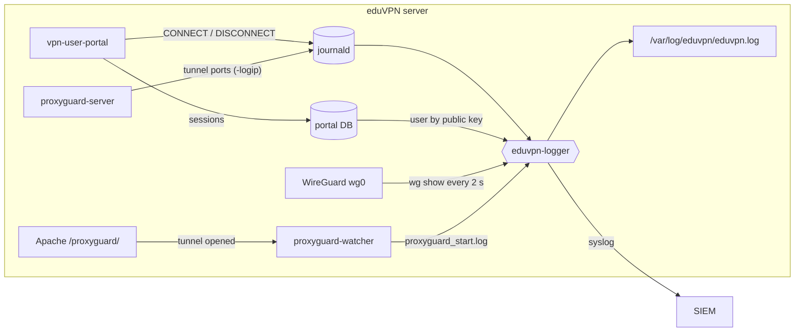
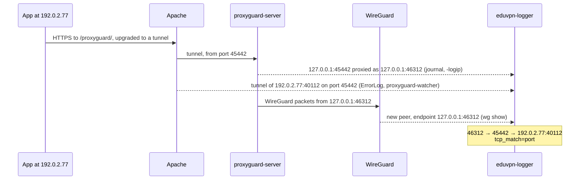

# eduvpn-logger

*🇮🇹 [Leggi in italiano](README.it.md)*

[](LICENSE)
[](#requirements)
[](https://www.eduvpn.org/)
[](#requirements)

**Who connected to your [eduVPN](https://www.eduvpn.org/) server, from where,
and when: one log line per WireGuard session event, in real time, ready for
your SIEM.**

eduVPN records the address a VPN client connects from only for OpenVPN: the
[eduVPN documentation](https://docs.eduvpn.org/server/v3/logging.html) states
that this *"is currently only available when clients connect using OpenVPN"*.
With WireGuard, no log answers the questions an incident response team sooner
or later has to answer: *which account was behind 203.0.113.45 last night?
Where did giulia connect from? When did that session start and end?* The portal
knows the user but not the address. WireGuard knows the address but not the
user, has no notion of a connection and logs nothing. Behind ProxyGuard,
eduVPN's WireGuard-over-HTTPS fallback, even the kernel sees every client as
`127.0.0.1`.

**eduvpn-logger closes that gap.** It follows the portal, WireGuard and Apache
in real time, joins them on the WireGuard public key and writes one
`key=value` line per session event (`connect`, `roam`, `disconnect`) to a file
and to syslog:

```
2026-04-15T09:58:03.412871+02:00 event=connect user=giulia profile=staff device=ios conn=soAQTNO...= tunnel_ip4="10.20.0.5" tunnel_ip6="fd00:20::5" src_ip="203.0.113.45" src_port=48049 transport=udp country="Italy" city="Trieste"
2026-04-15T10:41:22.090113+02:00 event=roam user=giulia profile=staff device=ios conn=soAQTNO...= tunnel_ip4="10.20.0.5" tunnel_ip6="fd00:20::5" src_ip_old="203.0.113.45" src_port_old=48049 src_ip="198.51.100.12" src_port=51234 transport=udp country="Italy" city="Trieste"
2026-04-15T11:02:57.731204+02:00 event=disconnect user=giulia profile=staff device=ios conn=soAQTNO...= bytes_in=227252 bytes_out=49292 src_ip="198.51.100.12" src_port=51234 transport=udp country="Italy" city="Trieste"
2026-04-15T12:10:04.861203+02:00 event=connect user=marco profile=students device=windows conn=GUUepz8z...= tunnel_ip4="10.20.1.9" tunnel_ip6="fd00:21::9" src_ip="192.0.2.77" src_port=40112 transport=tcp tcp_match=port country="Austria" city="Vienna"
2026-04-15T13:27:41.528310+02:00 event=disconnect user=marco profile=students device=windows conn=GUUepz8z...= bytes_in=18733211 bytes_out=402115980 src_ip="192.0.2.77" src_port=40112 transport=tcp inferred=1 country="Austria" city="Vienna"
```

*giulia connects from home, moves to the mobile network and disconnects; marco
reaches the server over ProxyGuard, then marco's laptop goes to sleep (public
keys shortened).*

- **Complete**: user, profile, device, tunnel addresses, public source IP and
  port (IPv4 and IPv6), transport, traffic, country and city.
- **Sees through ProxyGuard**: recovers the real address of clients that
  tunnel WireGuard over HTTPS, exactly with ProxyGuard 2.1.1 or later, and says
  how each one was found.
- **Self-contained**: a single-file Python daemon, standard library only, plus
  a small helper service for ProxyGuard. Nothing to compile, no patch to
  eduVPN, no kernel module.
- **Ready in one command** on every OS eduVPN 3 supports: it turns on what it
  needs in eduVPN, verifies every change and checks the result.
- **In production** at the University of Trieste (an earlier release).

## Contents

- [The problem](#the-problem)
- [What makes it different](#what-makes-it-different)
- [How it works](#how-it-works)
- [Requirements](#requirements)
- [Installation](#installation)
- [Configuration](#configuration)
- [Log format](#log-format)
- [Using the log](#using-the-log)
- [Limitations](#limitations)
- [Security and privacy](#security-and-privacy)
- [Upgrade and removal](#upgrade-and-removal)
- [FAQ](#faq)
- [Related projects](#related-projects)
- [Acknowledgements](#acknowledgements)
- [License](#license)

## The problem

On an eduVPN server every fact about a WireGuard session lives in a different
place, and none of them is enough on its own:

| Source | Knows | Does not know |
|---|---|---|
| Portal (`vpn-user-portal`) | user, profile, public key, tunnel addresses and traffic of each session | where the client connects from: logged only for OpenVPN |
| WireGuard | public key, current endpoint, last handshake and traffic of each peer | users, connections, history: it logs nothing, and a new endpoint silently replaces the old one |
| Apache, with ProxyGuard | the real address of each TCP tunnel | which WireGuard peer the tunnel carries; its access log writes a request only when it ends, days later for a long tunnel |
| proxyguard-server | which of Apache's connections each WireGuard source port belongs to: logged since ProxyGuard 2.1, when asked (`-logip`) | the client's address |

The WireGuard public key is the only identifier the portal and WireGuard
share, and only proxyguard-server, in between, can tell which Apache tunnel
reaches WireGuard from which port. Generic WireGuard loggers, such as
[wglogger](https://codeberg.org/flaruina/wglogger), record public keys and
endpoints but leave the join with the portal to you, and cannot see past
ProxyGuard, whose traffic reaches WireGuard from `127.0.0.1`. eduvpn-logger
rebuilds the missing links, in real time.

## What makes it different

- **Sessions on a connectionless protocol.** WireGuard only keeps the current
  endpoint and the time of the last handshake of each peer. eduvpn-logger reads
  them every 2 seconds and derives connect, roam and disconnect events from
  them: no kernel module, no conntrack or eBPF, no patch to eduVPN.
- **The real address behind ProxyGuard, exactly.** Apache knows the client of
  a TCP tunnel, WireGuard knows the peer, and only proxyguard-server knows which
  is which. With ProxyGuard 2.1.1 or later, eduvpn-logger has proxyguard-server
  log the Apache connection behind each source port WireGuard sees, and Apache
  log the port of that connection when the tunnel opens: the address is
  followed port by port from the WireGuard peer back to the client
  (`tcp_match=port`). With older ProxyGuard, which logs nothing per tunnel (or
  whose unit cannot be given `-logip` safely, 2.1.0), the
  tunnel start is matched to the WireGuard handshake in time
  (`tcp_match=time`), each start attributed once, and `tcp_candidates` says how
  many tunnels were possible, so an ambiguous match is visible as such.
- **Identity from the source of truth.** User and profile come from the
  portal: its database row for the session's public key (read-only), or else
  its CONNECT event. The portal writes user IDs
  into its log lines as they are, so a line where a user ID mimics the template
  (to pass for another user, or for another session's key) is set aside, never
  misread.
- **Restarts are seamless.** The journal position is saved after every portal
  event, and the open sessions when the service stops: after an upgrade or a
  reboot, events logged meanwhile are processed first, with their original
  timestamps, live sessions go on without a second `connect`, and those that
  ended meanwhile get their `disconnect`.
- **Built around eduVPN's real behaviour.** Peers re-created by
  `vpn-maint-apply-changes` (zeroed counters, no handshake) neither end their
  sessions nor lose their traffic totals. A public key reused through the API
  starts a fresh session. A NAT changing only the port is not a roam. A
  flapping mobile connection gives at most one roam line every 30 s, and the
  last move is never lost. A session closed by the portal while `wg show` is
  running is not brought back.
- **SIEM-friendly.** One line per event, keys in a fixed order, the event time
  carried into the syslog copy, and user-supplied values sanitised so that they
  cannot forge keys, while federated user IDs (eduPersonTargetedID,
  pairwise-id) are kept as they are.
- **Secure by default.** Portal events are accepted only from system accounts,
  by the sender's UID that journald records and the sender cannot forge, and
  proxyguard-server's lines only from its own service, by the unit journald
  records. The
  service runs in a systemd sandbox with four capabilities and no network
  access. Logs are private (`0640 root:adm`) and kept 180 days.
- **Ready to use.** `install.sh` installs it with one command, turns on the
  portal's connection log, Apache's ProxyGuard trace and proxyguard-server's
  tunnel log when they are off (each change verified before it is applied,
  with a backup, and a restart of proxyguard-server asked for), and checks the
  result; `install.sh --uninstall` removes it. Tested on Debian, Ubuntu, AlmaLinux and
  Fedora, and against real eduVPN 3 servers.

## How it works



The daemon reads these sources and joins them on the **WireGuard public key**:

| Source | What it provides | How it is read |
|---|---|---|
| portal events | user, profile, public key, tunnel IPs, traffic | journald, `SYSLOG_IDENTIFIER=vpn-user-portal`, from the saved position |
| portal database | user, profile, tunnel IPs and app of a public key | `/var/lib/vpn-user-portal/db.sqlite`, table `wg_peers`, read-only, at every CONNECT and for peers without a portal event |
| WireGuard | endpoint (public `IP:port`), last handshake, traffic of each peer | `wg show all dump`, every 2 s |
| ProxyGuard *(optional)* | real client `IP:port` of each TCP tunnel, when it opens, and the port of Apache's connection to proxyguard-server | Apache `ErrorLog` → `proxyguard-watcher` → `proxyguard_start.log` |
| proxyguard-server *(ProxyGuard 2.1+)* | the source port WireGuard sees for each of Apache's connections | journald, `SYSLOG_IDENTIFIER=proxyguard-server`, with `-logip` |

### From WireGuard state to sessions

WireGuard has no notion of a connection, so events are derived from the peer
state read at every poll:

- **connect**: a peer starts handshaking. If the portal has announced the
  session, the line is written at once, with the time of the portal event and
  the source of the handshake. Otherwise it waits up to 10 s for the portal
  event or the portal database to name the user, and carries the time of the
  first handshake. A session the portal announced that does not handshake
  within 2 minutes is written without a source, which follows in a roam line
  when the handshake comes.
- **roam**: the source of an active peer changes, including a switch between
  UDP and ProxyGuard. A change of the port alone (NAT rebinding) is ignored. At
  most one roam line per peer every 30 s: a move within that interval is
  written when the interval ends, stamped with the time it happened, unless the
  peer is back where it was.
- **disconnect**: when the eduVPN app disconnects, the portal's DISCONNECT is
  used, with its traffic counters. Otherwise (a generic WireGuard client, a
  laptop going to sleep, a lost network) the session ends after 180 s without a
  handshake, WireGuard's key lifetime, with WireGuard's own counters, and is
  stamped 180 s after the last handshake. When traffic resumes on the same key,
  a new session of the same user starts.

User and profile come from the portal database by public key, or else from the
portal's CONNECT event; tunnel addresses from the event, or else the database;
`-` if neither knows the key. A
session announced by the portal stays open until its DISCONNECT, however long
it takes to handshake: a configuration downloaded from the portal and first
used days later gets its source in a `roam` line.

`device` comes from the OAuth client ID of the eduVPN, Let's Connect! and
govVPN apps, as recorded by the portal. Connect and disconnect lines not
backed by a portal event carry **`inferred=1`** (roam lines always come from
WireGuard).

### ProxyGuard: recovering the real client address

On networks that block UDP the eduVPN apps reach WireGuard through
[ProxyGuard](https://docs.eduvpn.org/server/v3/wireguard.html): an HTTPS
connection to Apache, upgraded to a tunnel and handed to `proxyguard-server`,
which delivers the WireGuard packets to the local UDP port. WireGuard therefore
sees every such client as `127.0.0.1`, each tunnel from a port of its own.



Two lines describe each tunnel as it opens, with what `install.sh` sets up.
Apache (tracing ProxyGuard's requests only, whatever their path) writes
`AH10212 ... tunnel running` with the client, `[client 192.0.2.77:40112]`, and
the local port of its connection to proxyguard-server, `[pgport 45442]`;
`proxyguard-watcher` turns it into a tunnel-start event. proxyguard-server
(ProxyGuard 2.1 or later, `-logip`; set up by `install.sh` from 2.1.1) writes the source port that connection
gets towards WireGuard: `127.0.0.1:45442 proxied as 127.0.0.1:46312`. A
WireGuard peer that appears at `127.0.0.1:46312` is thus followed back to its
client: `tcp_match=port`. Ports are reused over time, so only lines of the
same moment are joined: the start and proxyguard-server's line within 5 s of
each other, both from the last 30 s.

Without proxyguard-server's line (ProxyGuard older than 2.1, which logs
nothing per tunnel; ProxyGuard 2.1.0 without the manual setup;
proxyguard-server not restarted since `install.sh`; a line
lost) a new WireGuard session, or a new tunnel of an active one, is matched to
the closest start in time, from about 30 s before to 3 s after WireGuard sees
it, leaving out the starts that proxyguard-server shows to belong to other
tunnels: `tcp_match=time`, with `tcp_candidates` the number of starts in the
window (`1`: no other candidate). Either way a start is claimed once, so it
cannot be given to another client, and if it has not arrived yet the connect
waits up to 20 s for it.

### Timing

| What | Default | Setting |
|---|---|---|
| WireGuard poll interval | 2 s | `EDUVPN_WG_POLL_SEC` |
| wait for the user of a new peer | 10 s | `EDUVPN_CONNECT_GRACE_SEC` |
| wait for the ProxyGuard start of a TCP session | 20 s | — |
| wait for the first handshake of a session announced by the portal | 120 s | — |
| ProxyGuard match window (by port and by time) | 30 s + one poll before, 3 s after WireGuard sees the tunnel | — |
| tunnel start and proxyguard-server's line of the same tunnel | within 5 s | — |
| minimum interval between roam lines of a peer | 30 s | `EDUVPN_ROAM_MIN_INTERVAL_SEC` |
| handshake silence before an inferred disconnect | 180 s (minimum) | `EDUVPN_DISCONNECT_AFTER_SEC` |

### State

`/var/lib/eduvpn-logger` keeps the journal position and, while the service is
stopped, the open sessions (`sessions.json`, readable by root only). On start
the sessions are restored and the file removed, the portal events logged
meanwhile are processed, as are the starts of the ProxyGuard tunnels opened
meanwhile, and only then is WireGuard read: a session the portal closed
meanwhile gets the portal's disconnect, one that went silent gets an inferred
one, a live one goes on (a ProxyGuard session keeps its real address).
Everything else is in memory and bounded by the live sessions: it is reconciled
with `wg show` at every poll, and the work per poll grows linearly with the
number of peers. After a crash there is no saved state: sessions still active
are announced again (see [Limitations](#limitations)). A corrupted or expired
journal position, or an unusable `sessions.json`, is detected, reported, and
the daemon starts from the present.

## Requirements

- eduVPN v3 server (`vpn-user-portal`) with WireGuard, on any OS eduVPN 3
  supports: Debian, Ubuntu, Enterprise Linux (RHEL, AlmaLinux, Rocky) and
  Fedora. Tested on Debian 13, Ubuntu 22.04, 24.04 and 26.04, AlmaLinux 9 and
  10, Fedora 43 and 44.
- Portal and WireGuard on the same host: the daemon reads the portal's journal
  and database and runs `wg show` locally. Multi-node setups, with the portal
  on a separate controller, are not supported.
- systemd; `wireguard-tools` (`wg`) and Python ≥ 3.9, standard library only
  (both installed by `install.sh` if missing).
- The connect/disconnect templates (recommended) need vpn-user-portal ≥ 3.5.0;
  the portal's default log format is also understood.
- The portal database is read only when it is SQLite, eduVPN's default. With
  PostgreSQL or MariaDB everything works from the portal's events, without the
  database fallback (see [Limitations](#limitations)).
- *Optional:* ProxyGuard 2.1.1 or later (`proxyguard-server` from the eduVPN
  repository, on the same host) for exact ProxyGuard source addresses; with an
  older one they are matched by time (2.1.0: exact with the
  [manual setup](#manual-setup) only).
- *Optional:* `python3-maxminddb` and a MaxMind GeoLite2-City database for
  `country` and `city` ([GeoIP](#geoip-optional)).

## Installation

On the eduVPN server:

```bash
git clone https://github.com/giacomocamata/eduvpn-logger.git
cd eduvpn-logger
sudo ./install.sh
```

On a standard eduVPN server nothing else is needed: `install.sh` installs the
logger, turns on what it needs on the eduVPN side if it is off, starts
everything and checks it. It is idempotent: re-run it to upgrade, or after
changing the eduVPN setup.

| Part | What `install.sh` does |
|---|---|
| portal connection log | if it is off, turns it on in `/etc/vpn-user-portal/config.php` with the recommended templates. The edit is checked with PHP before the file is replaced, the original is kept as `config.php.eduvpn-logger.bak`, and templates already set are kept. |
| ProxyGuard source IPs | if a VirtualHost proxies ProxyGuard (`/proxyguard/`, or any path upgraded to `UoTLV`): has Apache log tunnel starts, with a conf file of its own (`eduvpn-logger-proxyguard.conf`, then `configtest` and a graceful reload; if `configtest` fails, the previous version is kept, or none), and starts `proxyguard-watcher` on that VirtualHost's `ErrorLog` |
| ProxyGuard, exact (2.1.1 or later) | in the same conf file, server-wide, Apache's default error log format plus the port of each tunnel's connection to proxyguard-server, on trace lines only (an `ErrorLogFormat` of your own is left alone: see [Manual setup](#manual-setup)); a drop-in, `proxyguard-server.service.d/eduvpn-logger.conf`, that sets `OTHER_ARGS=-logip` for proxyguard-server, leaving its command line to the package. Restarting proxyguard-server drops the open ProxyGuard tunnels (the apps reconnect at once), so it is asked for; without a terminal it is left to you, with a note. With ProxyGuard older than 2.1, nothing is changed and the check says to upgrade it; with 2.1.0, whose unit has no `OTHER_ARGS`, nothing is changed either (overriding its command line could stop proxyguard-server after a package update): re-run `install.sh` once 2.1.1 is installed. |
| packages | `wireguard-tools`, `python3`, `logrotate`; optional `python3-maxminddb`, and `geoipupdate` with a MaxMind account (MaxMind's own package where the distribution has none, checked against its published checksums). Only missing ones: nothing already installed is upgraded. |
| programs, units | `/usr/local/sbin/eduvpn-logger.py`, `proxyguard-watcher.py`; `/etc/systemd/system/eduvpn-logger.service`, `proxyguard-watcher.service` |
| logs | `/var/log/eduvpn` (`2750 root:adm`), rotated daily by `/etc/logrotate.d/eduvpn-logger`. If rsyslog is installed and runs as root (Debian, EL, Fedora; not Ubuntu), the syslog copy is also written there, to `eduvpn-syslog.log`. Both files are yours to adapt (retention, forwarding): once changed, upgrades keep them, with a warning. |
| state | `/var/lib/eduvpn-logger` (journal position; open sessions while stopped) |

It ends with a check:

```
==> Check
  eduvpn-logger  active
  portal log     on
  portal DB      ok (128 WireGuard configurations)
  WireGuard      wg0
  ProxyGuard     watcher active, following /var/log/apache2/vpn.example.org_ssl_error.log
  PG sources     exact, by port (proxyguard-server 2.1.1 -logip)
  GeoIP          off (optional: sudo GEOIP_ACCOUNT_ID=<MaxMind account> ./install.sh)

==> Ready. Output: /var/log/eduvpn/eduvpn.log (also journalctl -t eduvpn-logger)
```

If something could not be done, `Ready` is replaced by the list of what is
left, which points to [Manual setup](#manual-setup). `portal log` reads
`on (portal's default format: no byte counters)` when the connection log was
already on without templates: it is understood and left as it is (a SIEM may
already parse it), but disconnects carry no traffic counters until the
templates are added.

### GeoIP (optional)

For `country` and `city`, create a free
[MaxMind account](https://www.maxmind.com/en/geolite2/signup) and a license
key, then run `install.sh` with the account ID. It asks for the license key,
so that the key stays out of the shell history (without a terminal, as from an
automation tool, pass `GEOIP_LICENSE_KEY` as well):

```bash
sudo GEOIP_ACCOUNT_ID=123456 ./install.sh
```

It installs `geoipupdate` if it is missing (from the distribution, or
[MaxMind's own package](https://github.com/maxmind/geoipupdate/releases) where
there is none, as on Enterprise Linux), writes `/etc/GeoIP.conf` (readable by
root only; an account already there gets the new credentials and keeps its
other settings), downloads GeoLite2-City and makes sure it is updated weekly,
as MaxMind's license requires: Debian and Ubuntu's `geoipupdate` has its own
timer, elsewhere `eduvpn-logger-geoipupdate.timer` is added. The daemon reopens
the database when it changes; a database, or a `python3-maxminddb` (from EPEL
on Enterprise Linux, which eduVPN's installer enables), that arrives after the
daemon started is used within an hour, without a restart. Location is looked
up only for public addresses.

### Verify

Connect a client with the eduVPN app and watch the output:

```bash
sudo tail -f /var/log/eduvpn/eduvpn.log
```

A `connect` line with the user and the public source IP should appear within a
few seconds of the tunnel coming up. Warnings from the daemon are in
`journalctl -u eduvpn-logger.service`.

| Symptom | Likely cause |
|---|---|
| no lines at all | the service is not running (`systemctl status eduvpn-logger`), or WireGuard cannot be read (warning `` `wg show all dump` failed ``): re-run `install.sh` and read its check |
| `inferred=1` on every connect and disconnect | the portal's connection log is off: re-run `install.sh` |
| `user=-` on connect lines | portal DB not found or not readable: check `EDUVPN_PORTAL_DB`; a PostgreSQL or MariaDB portal DB (see [Limitations](#limitations)); or peers of a non-eduVPN WireGuard interface: set `EDUVPN_WG_INTERFACES` |
| `transport=tcp src_ip="-"`, or the warning `ProxyGuard (TCP) session but no tunnel start read` | Apache not tracing ProxyGuard's requests, or the watcher reading the wrong `ErrorLog` (or an `ErrorLogFormat` of your own where `[client\ %a]` is not followed by the message, or by `[pgport ...]` and the message): re-run `install.sh` (also after changing the VirtualHost), then see `systemctl cat proxyguard-watcher` and the `tail` of `proxyguard_start.log` |
| `tcp_match=time` on ProxyGuard lines | ProxyGuard older than 2.1.1, proxyguard-server not restarted since `install.sh`, or an `ErrorLogFormat` of your own without `[pgport]`: the `PG sources` line of the check says which |
| warning `ignoring proxyguard-server entries from unit …` | a line with proxyguard-server's name was logged by another unit, e.g. with `logger -t proxyguard-server`: rejected (see [Limitations](#limitations)) |
| warning `ignoring unparsable/non-WireGuard event` | custom log template without `CONN=`, an OpenVPN event (ignored by design), or a line where a user ID mimics the template (set aside: the session is followed from WireGuard, the user from the portal database) |
| warning `untrusted _UID=…` | a portal event logged by a non-system account was rejected (see [Limitations](#limitations)) |

### Manual setup

Only needed where `install.sh` says so, or without it.

<details>
<summary>Portal connection log</summary>

In `/etc/vpn-user-portal/config.php`, inside the `Log` section:

```php
'Log' => [
    'syslogConnectionEvents' => true,
    // recommended (vpn-user-portal >= 3.5.0): parsed reliably and carries byte counters
    'connectLogTemplate'    => 'CONNECT USER={{USER_ID}} PROFILE={{PROFILE_ID}} PROTO={{VPN_PROTO}} CONN={{CONNECTION_ID}} IP4={{IP_FOUR}} IP6={{IP_SIX}}',
    'disconnectLogTemplate' => 'DISCONNECT USER={{USER_ID}} PROFILE={{PROFILE_ID}} PROTO={{VPN_PROTO}} CONN={{CONNECTION_ID}} BYTES_IN={{BYTES_IN}} BYTES_OUT={{BYTES_OUT}}',
],
```

The setting is read on the next portal request; `vpn-maint-apply-changes` is not
needed. Without the two templates the portal's default format is used and also
understood, but disconnects then carry no byte counters. Custom templates must
start with `CONNECT` / `DISCONNECT` and keep the `USER=`, `PROFILE=` and `CONN=`
keys. Reference:
[eduVPN logging](https://docs.eduvpn.org/server/v3/logging.html).
Check that events arrive (connect a client first):
`journalctl -t vpn-user-portal -n 5`.

</details>

<details>
<summary>ProxyGuard source IPs</summary>

Add to the eduVPN VirtualHost (full snippet:
[`examples/apache-proxyguard.conf`](examples/apache-proxyguard.conf)):

```apache
<If "%{HTTP:Upgrade} =~ /^UoTLV/i">
    LogLevel proxy:trace1
</If>
```

Apache then writes one `AH10212 ... tunnel running` line with `[client IP:port]`
to the VirtualHost `ErrorLog` when a tunnel opens; `proxyguard-watcher` turns it
into `proxyguard_start.log` next to Apache's logs (`/var/log/apache2`, or
`/var/log/httpd` on EL/Fedora), which the daemon reads. The `CustomLog` part of
the snippet is optional and not used by the daemon.

```bash
sudo apache2ctl configtest && sudo systemctl reload apache2    # EL/Fedora: apachectl, httpd
sudo systemctl enable --now proxyguard-watcher.service
```

`install.sh` points the watcher at the `ErrorLog` of the VirtualHost that
proxies ProxyGuard, e.g. `/var/log/apache2/vpn.example.org_ssl_error.log`
(`/var/log/httpd/vpn.example.org_ssl_error_log` on EL/Fedora). To follow
another file, override the command:

```bash
sudo systemctl edit proxyguard-watcher.service
```

```ini
[Service]
ExecStart=
ExecStart=/bin/sh -c 'exec tail -n 0 -F /path/to/error.log | python3 -u /usr/local/sbin/proxyguard-watcher.py'
```

</details>

<details>
<summary>ProxyGuard, exact source IPs (ProxyGuard 2.1 or later)</summary>

Apache: the error log format of the eduVPN VirtualHost, or server-wide, must
add the port of each tunnel's connection to proxyguard-server, right after the
client. This is Apache's default format plus that field:

```apache
ErrorLogFormat "[%{u}t] [%-m:%l] [pid\ %P% :tid\ %{g}T% ] %7F: %E: [client\ %a] [pgport\ %8{proxy-source-port}n] %M% ,\ referer:\ %{Referer}i"
```

Before Apache 2.4.60 the default logs `%T` instead of `%{g}T`. With an
`ErrorLogFormat` of your own, add `[pgport\ %8{proxy-source-port}n]` right
after `[client\ %a]`. `%8` keeps the field to trace lines (the tunnel start):
other lines are written as before.

proxyguard-server must log its tunnels. With a unit whose `ExecStart=` ends
with `${OTHER_ARGS}` (ProxyGuard 2.1.1 or later), set `OTHER_ARGS=-logip` with
a drop-in (`sudo systemctl edit proxyguard-server.service`, then
`[Service]` and `Environment=OTHER_ARGS=-logip`), or in
`/etc/default/proxyguard-server` (`/etc/sysconfig/proxyguard-server` on
EL/Fedora), which wins over the drop-in.

ProxyGuard 2.1.0's unit has no other way to pass `-logip` than its command
line. `install.sh` does not write it, but once it is there it sees it and
sets up Apache's part. At your own risk: repeat the unit's
`ExecStart=` line (`systemctl cat proxyguard-server`; on EL/Fedora it starts
with `proxyguard-server`, without `/usr/sbin/`) with `-logip` added. The copy
does not follow package updates: if one changes that line, proxyguard-server
keeps the old one, or does not start, until you update the drop-in.

```bash
sudo systemctl edit proxyguard-server.service
```

```ini
[Service]
ExecStart=
ExecStart=/usr/sbin/proxyguard-server -listen ${LISTEN} -to ${TO} -logip
```

Remove this drop-in when 2.1.1 arrives (then re-run `install.sh`), and before
downgrading proxyguard-server below 2.1, which does not start with `-logip`.

To apply either setting, restart proxyguard-server at a quiet time, since the
open ProxyGuard tunnels drop and the apps reconnect:

```bash
sudo systemctl restart proxyguard-server
```

</details>

<details>
<summary>Installation without <code>install.sh</code></summary>

```bash
sudo apt install -y wireguard-tools python3 logrotate    # dnf on Fedora/EL
sudo install -m 0755 eduvpn-logger.py proxyguard-watcher.py /usr/local/sbin/
sudo install -m 0644 systemd/eduvpn-logger.service systemd/proxyguard-watcher.service /etc/systemd/system/
sudo install -m 0644 examples/logrotate-eduvpn /etc/logrotate.d/eduvpn-logger
sudo install -m 0644 examples/rsyslog-10-eduvpn.conf /etc/rsyslog.d/10-eduvpn.conf   # only with rsyslog running as root
sudo install -d -m 2750 -o root -g adm /var/log/eduvpn
sudo systemctl daemon-reload
sudo systemctl enable --now eduvpn-logger.service
```

Then the sections above. For GeoIP, configure `geoipupdate` and schedule it
weekly (`systemd/eduvpn-logger-geoipupdate.timer`).

</details>

## Configuration

All settings are environment variables with defaults for a standard eduVPN
server. Change them with a systemd drop-in, which survives re-installs (the
unit file itself lists every variable for reference). A value that is not a
number is ignored with a warning in `journalctl -u eduvpn-logger`, and the
default is used:

```bash
sudo systemctl edit eduvpn-logger.service
```

```ini
[Service]
Environment=EDUVPN_GEOIP_LANG=it,en
```

```bash
sudo systemctl restart eduvpn-logger.service
```

| Variable | Default | Meaning |
|---|---|---|
| `EDUVPN_LOG` | `/var/log/eduvpn/eduvpn.log` | output file |
| `EDUVPN_PORTAL_DB` | `/var/lib/vpn-user-portal/db.sqlite` | portal database (read-only) |
| `EDUVPN_PROXYGUARD_START_LOG` | `/var/log/apache2/proxyguard_start.log` (`/var/log/httpd/…` on EL/Fedora) | file written by `proxyguard-watcher`: set it for `proxyguard-watcher.service` too |
| `EDUVPN_STATE_DIR` | `/var/lib/eduvpn-logger` | journal position; open sessions while the service is stopped |
| `EDUVPN_GEOIP_DB` | *(searched)* | path of `GeoLite2-City.mmdb`; by default looked for in `/usr/local/share/GeoIP`, `/usr/share/GeoIP` and `/var/lib/GeoIP` |
| `EDUVPN_GEOIP_LANG` | `en` | language(s) of place names, first match wins, e.g. `it,en` |
| `EDUVPN_SYSLOG_IDENT` | `eduvpn-logger` | syslog program name |
| `EDUVPN_SYSLOG_FACILITY` | `local0` | syslog facility |
| `EDUVPN_WG_POLL_SEC` | `2.0` | `wg show` polling interval, seconds (minimum 0.5) |
| `EDUVPN_CONNECT_GRACE_SEC` | `10.0` | max wait for user attribution before writing a connect |
| `EDUVPN_DISCONNECT_AFTER_SEC` | `180.0` | handshake silence before an inferred disconnect; values below 180 are raised to 180 |
| `EDUVPN_ROAM_MIN_INTERVAL_SEC` | `30.0` | minimum interval between roam lines per peer |
| `EDUVPN_WG_INTERFACES` | *(all)* | WireGuard interfaces to follow, comma-separated, e.g. `wg0`; set it if the server runs other WireGuard tunnels |

To try settings without touching the service, run a second instance with its
own output and state directory, in a new directory only root can use (not a
fixed name under `/tmp`, which another user could create first):

```bash
T=$(sudo mktemp -d)
sudo EDUVPN_LOG=$T/test.log EDUVPN_STATE_DIR=$T EDUVPN_SYSLOG_IDENT=eduvpn-logger-test /usr/local/sbin/eduvpn-logger.py
```

### Sending the events to a SIEM

Either point the SIEM's agent (Elastic Agent, Splunk Universal Forwarder,
Wazuh and the like) at `/var/log/eduvpn/eduvpn.log`, one event per line, or
forward the syslog copy, which goes to the journal
(`journalctl -t eduvpn-logger`) and, with rsyslog running as root, to
`/var/log/eduvpn/eduvpn-syslog.log`. With rsyslog, put this in
`/etc/rsyslog.d/10-eduvpn.conf` (upgrades keep it once changed):

```
if $programname == 'eduvpn-logger' then {
    action(type="omfile" file="/var/log/eduvpn/eduvpn-syslog.log")   # not on Ubuntu (see Installation)
    action(type="omfwd" target="siem.example.org" port="514" protocol="tcp")
    stop
}
```

then run `sudo systemctl restart rsyslog`. For TLS or RELP see rsyslog's
`omfwd` and `omrelp` modules. In the SIEM, take the event time from the `ts`
key (see [Log format](#log-format)).

## Log format

`<ISO-8601 timestamp, µs, UTC offset> key=value ...`. The timestamp is when the
event happened, not when the line was written, so lines are not strictly in
timestamp order: a connect held for its source, or a roam held back by the
30 s limit, can be written up to two minutes later. The lines of one session
are always written in order (connect, roam, disconnect). Keys come in a fixed
order; optional keys are left out when they do not apply, and unknown values
are `-`. Values that may contain `:` or spaces are double-quoted; values that
come from the portal or the IdP (`user`, `profile`, tunnel addresses, byte
counters) are sanitised: whitespace, double quotes and control characters
become `_`, so they cannot inject extra keys. `=` is kept: within one value it
starts no new key, and federated user IDs often end with it, as this
eduPersonTargetedID does:
`user=https://idp.example.org/idp/shibboleth!https://vpn.example.org/...!xEfu4jG6kKnf=`.
New keys may be added in future versions: ignore unknown ones.

The syslog copy (facility `local0`, priority `info`) carries the same keys
without the leading timestamp, since syslog stamps the time the line was
written, and adds the event time as `ts="<ISO-8601>"` at the end: use that one
in the SIEM.

| Field | Events | Meaning |
|---|---|---|
| `event` | all | `connect`, `roam`, `disconnect` |
| `user`, `profile` | all | from the portal or its DB; `-` if unknown |
| `device` | when known | `android`, `ios`, `windows`, `macos`, `linux` (eduVPN, Let's Connect! or govVPN app) |
| `conn` | all | WireGuard public key: the session key across lines |
| `tunnel_ip4`, `tunnel_ip6` | connect, roam | addresses assigned inside the VPN |
| `bytes_in`, `bytes_out` | disconnect | traffic seen from the server (`in` = sent by the client): from the portal, or WireGuard counters for inferred disconnects; `-` with the portal's default log format |
| `src_ip_old`, `src_port_old` | roam | source address before the roam |
| `src_ip`, `src_port` | all | public source address, IPv4 or IPv6; `-` if unknown |
| `transport` | all | `udp`, `tcp` (ProxyGuard) or `unknown` |
| `tcp_match` | connect, roam over `tcp` with a source | how it was found: `port`, through the tunnel's ports (exact); `time`, the closest tunnel start in time |
| `tcp_candidates` | connect, roam with `tcp_match=time` | tunnel starts the source IP was chosen among; `1` = no other candidate (see [Limitations](#limitations)) |
| `inferred` | connect, disconnect | `1`: derived from WireGuard state, not reported by the portal |
| `country`, `city` | with GeoIP, public IPs | location of `src_ip` |

Most SIEMs extract `key=value` pairs natively (for example Splunk's automatic
key-value extraction, the Elasticsearch `kv` processor or the Logstash `kv`
filter). In Python:

```python
import re
KV = re.compile(r'(\w+)=("[^"]*"|\S+)')
fields = {k: v.strip('"') for k, v in KV.findall(line)}
```

## Using the log

Rotated files are dated and compressed (`eduvpn.log-20260415.gz`): `zgrep`
reads them together with the current one.

```bash
# Who was behind a public address (also as the old address of a roam)
zgrep -hE 'src_ip(_old)?="203\.0\.113\.45"' /var/log/eduvpn/eduvpn.log*

# Everything one user did
zgrep -h ' user=giulia ' /var/log/eduvpn/eduvpn.log*

# Who had a tunnel address, e.g. one seen in a firewall log: the connect line
# names the user and the public key, then follow the key to its disconnect
zgrep -h 'tunnel_ip4="10.20.0.5"' /var/log/eduvpn/eduvpn.log*
zgrep -hF ' conn=<public key> ' /var/log/eduvpn/eduvpn.log*

# Connections from abroad (with GeoIP)
zgrep -h ' event=connect .*country=' /var/log/eduvpn/eduvpn.log* | grep -v 'country="Italy"'
```

## Limitations

- **ProxyGuard source IPs are exact from ProxyGuard 2.1.1.** With
  proxyguard-server's `-logip` and Apache's `[pgport]` (both set up by
  `install.sh`), each tunnel is followed port by port from WireGuard to the
  client (`tcp_match=port`). Without them (ProxyGuard older than 2.1, which
  logs nothing per tunnel; 2.1.0 without the manual setup; proxyguard-server
  not restarted yet; an
  `ErrorLogFormat` of your own without `[pgport]`; a line lost, as when
  journald rate-limits a flood of tunnels) the closest start of the previous
  30 s is used, once (`tcp_match=time`): clients opening TCP tunnels within the
  same few seconds can be swapped, and `/proxyguard/` is reachable without
  authentication. Treat `tcp_candidates` above 1 as probable, not certain; `1`
  holds only if the watcher sees every tunnel start (if one is missing, the
  start left may be another client's). UDP source IPs come from the kernel and
  are exact. Several proxyguard-server instances on one host must be units
  named `proxyguard-server*.service`; one on another host (a dedicated proxy)
  is not followed.
- **Apache's error log format is set server-wide** (ProxyGuard 2.1.1 or later).
  It is Apache's default plus `[pgport N]` on trace lines only, which only
  ProxyGuard's tunnel starts have, so other tools reading Apache's error logs
  see the same lines as before; the one difference is that debug lines about
  a backend connection read `[client …]` instead of `[remote …]`.
- **Addresses are those the server sees.** A load balancer, firewall or reverse
  proxy in front of the server that rewrites source addresses (SNAT) hides the
  clients behind its own address. For ProxyGuard behind an HTTP reverse proxy,
  have Apache log the real client with `mod_remoteip` (`[client %a]` is then
  the client's address).
- **Portal events are trusted by sender.** Any local user can write to the
  journal with `logger -t vpn-user-portal`; only entries whose `_UID` (set by
  journald) is a system account (≤ `SYS_UID_MAX`, normally 999: root,
  `www-data`, `apache`) are accepted. proxyguard-server runs as a dynamic user,
  with no fixed UID: its lines are accepted only from its own service
  (`_SYSTEMD_UNIT`, also set by journald, which only root can name).
- **Inferred disconnects** are written, and timestamped, when the 180 s
  silence threshold is crossed, i.e. up to 3 minutes after the last activity.
- **While the daemon is stopped**, roams are not followed (a session that
  moved is reported once, from where it was to where it is, when the daemon
  starts again), nor are handshakes WireGuard forgets meanwhile: if the
  interface is re-created during a stop (a reboot, `vpn-maint-apply-changes`),
  a session whose last known handshake is over 180 s old ends there, and its
  next traffic starts a new one.
- **After a crash** (`kill -9`, out of memory, power loss) there is no saved
  state: active peers get a new `connect` with `inferred=1`, timestamped with
  their last handshake (up to 3 minutes earlier) and the source seen after the
  restart; for ProxyGuard sessions `src_ip="-"` (the line written before has
  the IP).
- **Portal database on PostgreSQL or MariaDB**: it is not read, so a session
  with no portal event at all (after a crash, or a non-eduVPN peer) gets
  `user=-`. Sessions announced by the portal, and new sessions on their keys,
  are unaffected. Users then come from the portal's log lines alone, where a
  user ID is written as it is: one containing a space followed by capital
  letters and `=` (`giulia X=1`) is cut there (`giulia`).
- **Sampling.** WireGuard is read every `EDUVPN_WG_POLL_SEC`: a roam and back
  within one interval is not seen, and a session shorter than one interval has
  no source address (its connect and disconnect still come from the portal).

## Security and privacy

The log contains personal data (user IDs, public IPs, location): define purpose,
legal basis and retention with your Data Protection Officer.

- **Access**: logs are created `0640 root:adm` in a `2750` directory.
- **Retention**: `/etc/logrotate.d/eduvpn-logger` rotates daily and keeps 180
  days; change `rotate` to your policy (upgrades keep your change).
  `proxyguard_start.log` follows the distribution's Apache rotation (14 days on
  Debian and Ubuntu).
- **Integrity**: anyone with root on the server can alter a local file; for
  evidential use, forward the events to a remote collector in real time
  ([Sending the events to a SIEM](#sending-the-events-to-a-siem); with
  rsyslog, `omfwd` over TLS or RELP).
- **Privileges**: both services run as root inside a systemd sandbox (with
  SELinux, on EL/Fedora, as `unconfined_service_t`: no policy module needed).
  `eduvpn-logger` keeps only `CAP_NET_ADMIN` (`wg show`),
  `CAP_DAC_READ_SEARCH`/`CAP_DAC_OVERRIDE` (reading the portal DB) and
  `CAP_CHOWN` (a WAL-mode DB gets `-wal`/`-shm` files that must belong to the
  portal), and can open only local (`AF_UNIX`) and netlink sockets: no network
  connections. `proxyguard-watcher` has no capabilities and no network. Inspect
  with `systemd-analyze security eduvpn-logger.service`.
- **Read-only towards eduVPN**: the portal database is opened read-only, and
  the daemon never writes to eduVPN's files or to WireGuard.

## Upgrade and removal

Upgrade (drop-ins and logs are kept; running services are restarted, their
open sessions carrying over, and a service you stopped or disabled is left
alone; the eduVPN side is checked as on a first install):

```bash
cd eduvpn-logger && git pull && sudo ./install.sh
```

Settings that an older version had you edit directly into the unit files
(`Environment=` lines, the watcher's `ErrorLog` path) are moved to
`<unit>.d/00-migrated.conf` before the units are replaced. A version from
before 12 October 2026 saves no sessions when it stops: upgrading from it, the
sessions open at that moment are announced again once (`inferred=1`), as after
a crash.

After upgrading proxyguard-server from 2.1.0 or older to 2.1.1 or later,
re-run `install.sh` once: only then are ProxyGuard sources exact. Later
updates, and a downgrade, need nothing: the drop-in only sets `OTHER_ARGS`,
which an older unit does not use (re-running `install.sh` then removes it). To
go back to an earlier version of eduvpn-logger, run this version's
`install.sh --uninstall` first: an earlier `proxyguard-watcher` does not read
tunnel starts that carry `[pgport]`.

Removal:

```bash
cd eduvpn-logger && sudo ./install.sh --uninstall
```

It stops and removes the services, the programs, the units with their
drop-ins, the state, the logrotate policy, the rsyslog snippet (unless changed
locally), Apache's trace of ProxyGuard tunnels and error log format (Apache is
reloaded) and proxyguard-server's drop-in (proxyguard-server logs its tunnels
until it next restarts, which drops the open ProxyGuard tunnels). It
leaves the logs in `/var/log/eduvpn` (personal data: delete them as your
retention policy says), the portal's connection log (if `install.sh` turned it
on, the previous `config.php` is in `config.php.eduvpn-logger.bak`),
`/etc/GeoIP.conf` and the packages. A trace block added to the VirtualHost by
hand stays too.

## FAQ

**Does it change eduVPN?** It only reads the portal's journal and database,
WireGuard's state, proxyguard-server's journal and Apache's log. `install.sh`
changes, only where they are off, the portal's connection log and, with
ProxyGuard, Apache's log level for ProxyGuard's requests, Apache's error log
format and proxyguard-server's `-logip`: in `config.php` (with a backup) and in
files of its own (an Apache conf file, a systemd drop-in), never in eduVPN's
packaged files. Each change is verified before it is applied, and the restart
of proxyguard-server is asked for.

**What does it cost?** One `wg show all dump` every 2 s and a read-only SQLite
query per new session (a few for a peer the portal does not know). Memory and
CPU grow linearly with the number of peers, and each portal event or tunnel
start costs the same however many sessions are open: with 10,000 peers a poll
takes about 20 ms, and announcing all of them again after a crash about 2 s.

**What about OpenVPN?** The portal already logs the client address of OpenVPN
sessions (`originatingIp`); eduvpn-logger ignores them.

**Can I trust the source IP?** Over UDP, yes: it comes from the kernel, as the
server sees it (see [Limitations](#limitations)). Over ProxyGuard, with
`tcp_match=port` yes: it follows the tunnel's ports from WireGuard to Apache's
client; with `tcp_match=time` it is a time match, with `tcp_candidates`
telling how many tunnels were possible.

**What happens while the logger is stopped?** Portal events are processed when
it starts again, with their original timestamps. Sessions still active go on
with no new `connect`; those that ended meanwhile get their `disconnect`; roams
in between are not seen. Only after a crash are active sessions announced
again, with `inferred=1`.

**Several eduVPN nodes?** Not supported: the portal and WireGuard must run on
the same host.

## Related projects

- [eduvpn-fortigate-rsso](https://github.com/giacomocamata/eduvpn-fortigate-rsso)
  follows this log and sends every session's user and tunnel address to a
  FortiGate as RADIUS Accounting (RSSO), for identity-based firewall policies
  and per-user firewall logs.

## Acknowledgements

eduvpn-logger grew out of a first version built on
[wglogger](https://codeberg.org/flaruina/wglogger) by Francesco Laruina
(INFN), which showed how to turn WireGuard's state into connect, roam and
disconnect events by mapping each endpoint to its peer's public key. Reading
that same mapping straight from `wg show` is what made this daemon
self-contained. The `-logip` option of ProxyGuard 2.1, which he co-authored
with Jeroen Wijenbergh (GÉANT), is what makes the ProxyGuard match exact.

## License

MIT, see [LICENSE](LICENSE).
